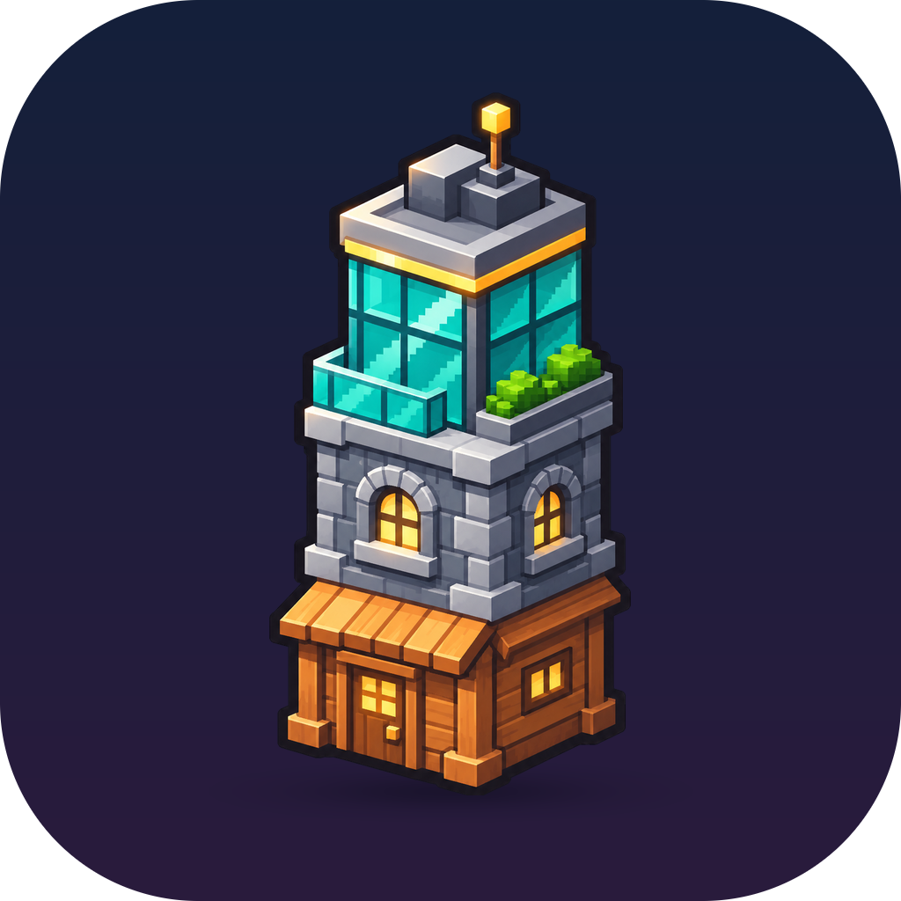
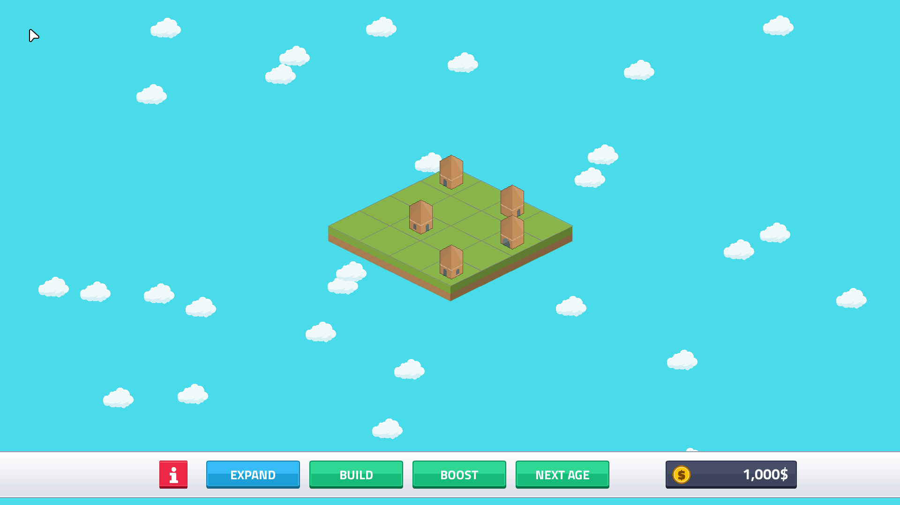
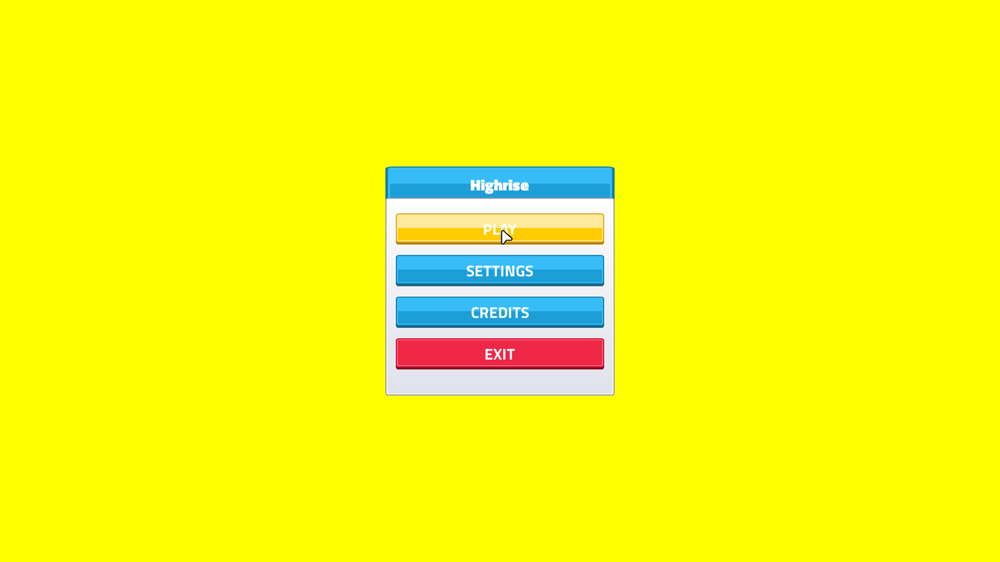
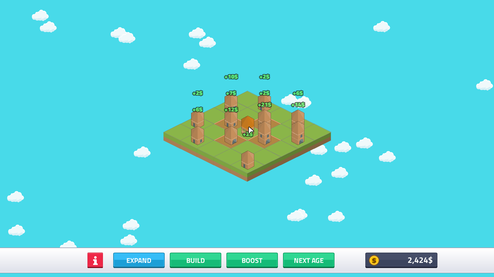
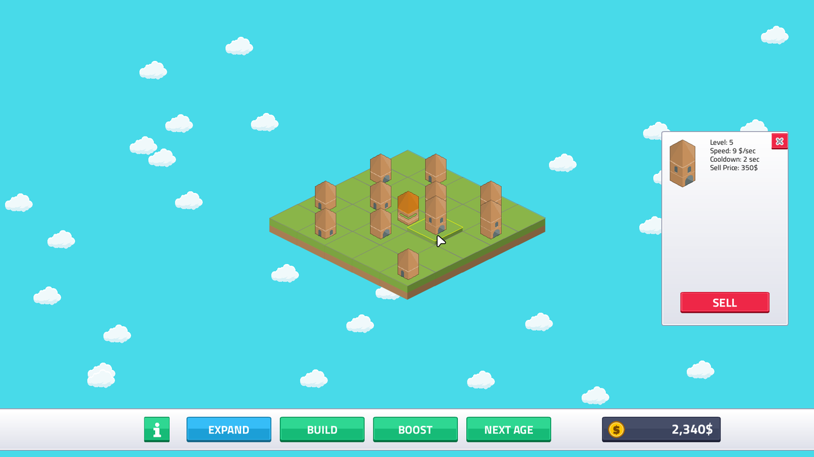

<p align="center"></p>

# Highrise

<div align="center">

[](https://github.com/vectorviolet/highrise/actions/workflows/ci.yml)
[](https://github.com/vectorviolet/highrise/releases/latest)
[](LICENSE)
[](https://github.com/vectorviolet/highrise/actions/workflows/ci.yml)
[](https://github.com/pygame-community/pygame-ce)

</div>

An isometric city-builder where same-level buildings merge `2048`-style: slide them together, watch them grow taller and richer, expand the land and advance through four ages. Built with Python and [pygame-ce](https://github.com/pygame-community/pygame-ce) on the author's own [pygamine](https://github.com/vectorviolet/pygamine) engine layer.



## Gameplay

Place buildings on the isometric grid, then slide them with WASD or the arrow keys to merge same-level neighbors into a higher-level building, just like 2048. Higher-level buildings earn more income. Spend it to build, expand the land, or advance to the **next age** for better-looking buildings; each age's tasks (reach a building level, earn so much per second, boost some buildings) must be done first. **BOOST** puts a booster on the board that raises the income of the buildings on the tiles it covers. English and Turkish, with display, audio and game settings; leaving the board for the menu saves your game, and CONTINUE resumes it.

## Screenshots

| Menu | Build mode | Inspection |
|------|------------|------------|
|  |  |  |

## Controls

| Action | Input |
|---|---|
| Move building (merge direction) | WASD / Arrow keys |
| Construct a building | Spacebar |
| Toggle inspection mode | INFORMATION button |
| Build a new building | BUILD button |
| Place a booster (after the first age's tasks) | BOOST button |
| Expand the land | EXPAND button |
| Advance to next age | NEXT AGE button |
| Inspect / sell building | Click a building in inspection mode |

## Download

[](https://umutcanekinci.itch.io/highrise)

Grab a ready-to-play build for your OS from [itch.io](https://umutcanekinci.itch.io/highrise) or the [latest GitHub release](https://github.com/vectorviolet/highrise/releases/latest) — no Python required. Unzip and run:

| OS | Run |
|----|-----|
| Windows | Extract `highrise-windows.zip`, run `highrise.exe` |
| macOS | Extract `highrise-macos.zip`, open `Highrise.app` |
| Linux | Extract `highrise-linux.zip`, run `./highrise/highrise` |

> macOS Gatekeeper: the app is unsigned, so the first launch needs **right-click → Open** (or `xattr -dr com.apple.quarantine Highrise.app`).
>
> Windows SmartScreen: the app is unsigned, so the first launch shows **"Windows protected your PC."** Click **More info → Run anyway**. This is Microsoft's download-reputation check, not a virus warning — brand-new unsigned executables always trigger it.

## Running from source

Needs Python 3.12+ and [uv](https://docs.astral.sh/uv/), which also installs the pygamine engine from its submodule.

```bash
git clone --recurse-submodules https://github.com/vectorviolet/highrise.git
cd highrise
uv sync
uv run python __main__.py
```

If you forgot `--recurse-submodules`, or the engine folder is out of step after a pull:
`git submodule update --init` (on Windows, `scripts\sync-pygamine.bat` does the same). Without `uv`: `pip install .` then `python __main__.py`.

Tests, code style, bundles and releases are in [CONTRIBUTING.md](CONTRIBUTING.md); how the code fits together is in [docs/ARCHITECTURE.md](docs/ARCHITECTURE.md).

## Links

- [Devlog](docs/devlog/README.md): every feature and design decision, with screenshots; [decision records](docs/decisions/README.md)
- [Changelog](CHANGELOG.md)
- [Contributing](CONTRIBUTING.md) and [architecture](docs/ARCHITECTURE.md)
- [itch.io page](https://umutcanekinci.itch.io/highrise) and [releases](https://github.com/vectorviolet/highrise/releases)

## Credits

Art, UI and sounds from [Kenney](https://www.kenney.nl/) — [Hexagon Buildings](https://www.kenney.nl/assets/hexagon-buildings) and [UI Pack](https://www.kenney.nl/assets/ui-pack) (CC0); the font is [Titillium Web](https://fonts.google.com/specimen/Titillium+Web) (SIL OFL 1.1). Music : Sakura Girl - Day Off (CC BY 3.0), link : [youtu.be/vAv9KtrU_5c](https://youtu.be/vAv9KtrU_5c). See [CREDITS.md](CREDITS.md) for every asset, font and library with its license; it also ships with the game.

## Asset sources

Every file under `assets/` is listed in `assets/SOURCES.yaml` with its source:

- **A pack**, given by its slug (for example `kenney-ui-pack`). The entry also gives the file's
  path inside that pack as `original`. Images built from several pack files list them under
  `composited_from` instead. Edited pack files say what changed under `modified`.
- **`own`**, for files made for this game.

The `packs` section names each pack, its author, URL, license and what the game uses it for.
Each pack's own license text is in `licenses/assets/<slug>.txt`, and every build ships it.

When you add, replace or remove an asset:

1. Update `assets/SOURCES.yaml`, and add `licenses/assets/<slug>.txt` for any new pack.
2. Run `uv run python scripts/gen_credits.py` to regenerate CREDITS.md's asset section. Don't
   edit that section by hand.
3. Run the tests. `tests/test_sources.py` fails if a file is missing from `SOURCES.yaml`, if a
   listed file doesn't exist, if a pack has no license text, or if CREDITS.md is out of date.

Only use assets whose license allows bundling them in a distributed game.

## Author

[Umutcan Ekinci](https://www.linkedin.com/in/umutcanekinci/)

Built with Claude Code as a coding assistant; game design, art direction, playtesting and review by me.

## License

This project is licensed under the MIT License — see the [LICENSE](LICENSE) file. The icon, cover, banner and key arts in `docs/design/` are not CC0: they were generated by the owner with OpenAI Codex (see [docs/design/README.md](docs/design/README.md)).
