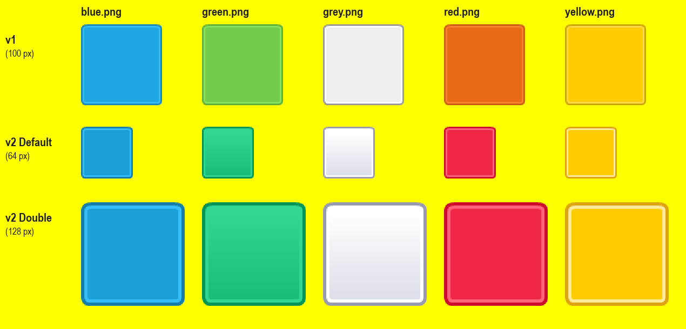
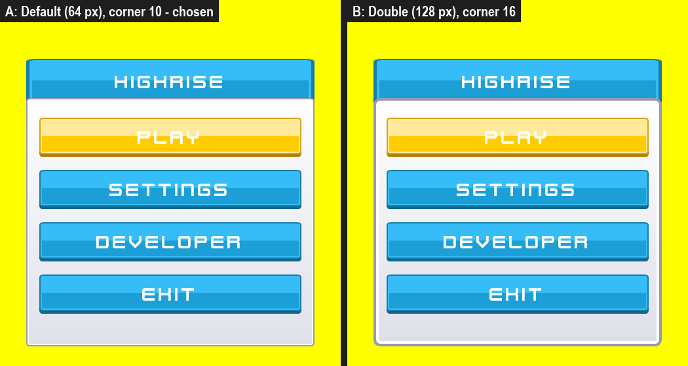
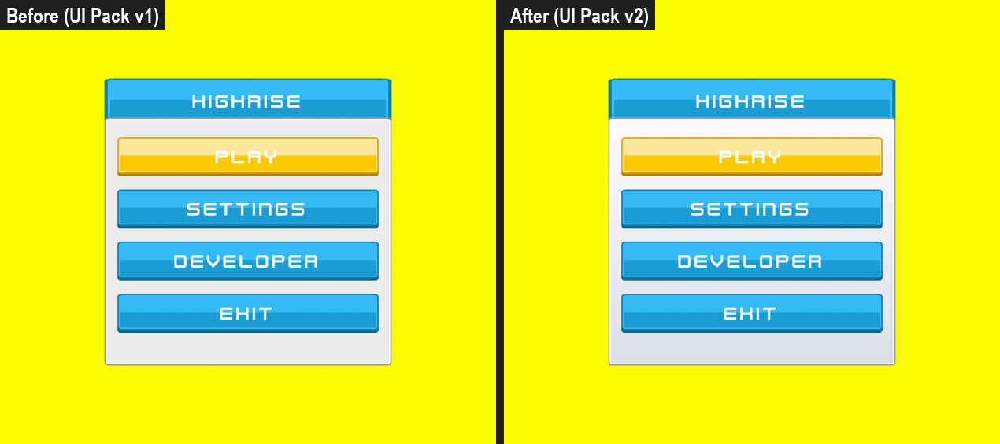
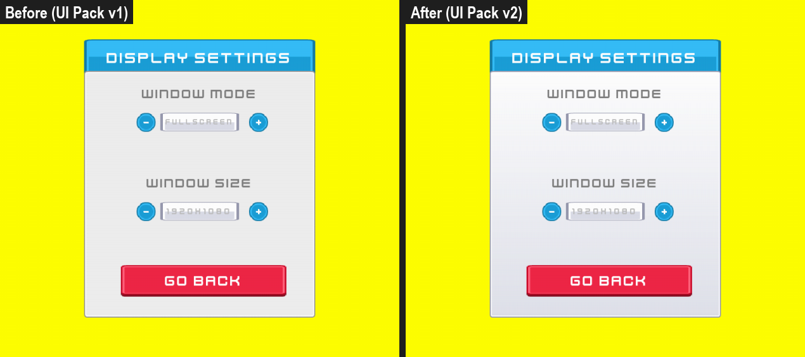
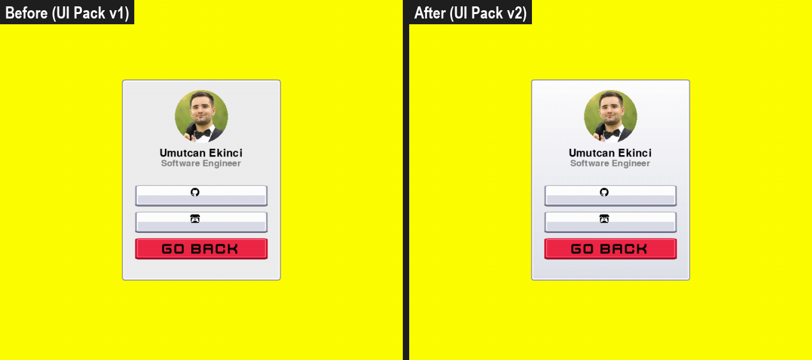
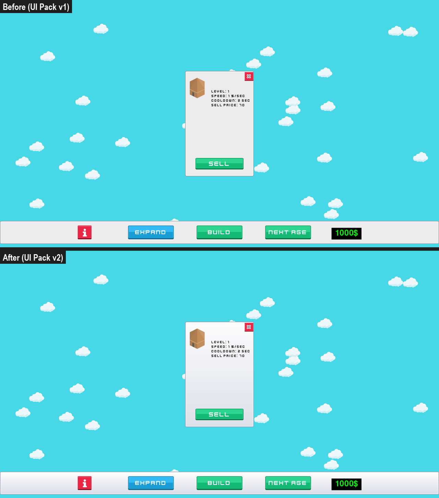

# Panels from UI Pack v2

**Date:** 2026-10-28 · **Area:** Art, UI · **Issue:** [#12](https://github.com/vectorviolet/highrise/issues/12) · **PR:** [#13](https://github.com/vectorviolet/highrise/pull/13)

## Context

Five panel images in `assets/images/gui/panels/` came from Kenney's **UI Pack version 1**, a pack
kenney.nl no longer offers. Everything else in the UI already comes from the current UI Pack (v2).
The owner asked to replace the five files with their closest v2 images and drop the v1 pack, and
gave the mapping:

| File | v2 image |
|---|---|
| `blue.png` | `Blue/…/button_square_flat.png` |
| `green.png` | `Green/…/button_square_gradient.png` |
| `grey.png` | `Grey/…/button_square_gradient.png` |
| `red.png` | `Red/…/button_square_flat.png` |
| `yellow.png` | `Yellow/…/button_square_flat.png` |

Only `grey.png` is drawn today (the `grey_panel` asset behind every `menu_panel`: menu, play,
settings, display, audio, game settings, developer, the game's bottom bar and the building info
panel). The other four colours are not referenced anywhere; they were replaced too, so the folder
keeps one consistent set.

## Options

Each v2 image comes in two sizes: `Default` (64 px) and `Double` (128 px). The panels are drawn
with a nine-slice (`nine_slice` in `config/panels.yaml`): the corners stay at native size and the
rest stretches.

<table>
<tr>
<td> A: Default with the existing corner of 10 px (left). B: Double with a corner of 16 px (right).</td>
</tr>
</table>

## Decision

Default (64 px) for all five, with the existing `nine_slice: 10` unchanged (default chosen by
Claude, for the owner to approve at merge). Its 2 px outline and 6 px corner radius match the v1
panels and the Default-size buttons drawn on top of them, and a 10 px corner covers the rounded
corner, outline and inner highlight, so corners stay clean at every size used (300×460 up to
1920×100).

Text: the grey labels (`[128, 128, 128]`) sit in the upper and middle part of the gradient, where it
is as light as or lighter than the old flat grey (contrast 3.5–3.9 against 3.4 before); black text
on the info panel and the bottom bar is unchanged (17–19). No text colour was changed.

## Rejected alternatives

- Double (128 px): its 4 px outline looks heavier than the buttons it frames, and it needs a larger
  corner value.
- Deleting the four unused colours: possible, but the owner's mapping covers all five, and keeping
  them costs a few hundred bytes each.

## Result

The `kenney-ui-pack-v1` source and `licenses/assets/kenney-ui-pack-v1.txt` are removed; the five
files are listed under `kenney-ui-pack` in `assets/SOURCES.yaml` with their v2 paths.

## Revisit if

- Panels get smaller than about 30 px, or a coloured panel (blue, green, red, yellow) is put into
  use: check the corners and the text colour on it.
