# Language (English and Turkish), Skip intro and a new font
<!-- index | refs: #29, PR #34 | area: UI, Localization -->

**Date:** 2026-11-04 · **Area:** UI, Localization · **Issue:** [#29](https://github.com/vectorviolet/highrise/issues/29) · **PR:** [#34](https://github.com/vectorviolet/highrise/pull/34)

## Context

The GAME SETTINGS page was a "coming soon" placeholder, and every visible string was written into
`config/panels.yaml` or the Python code. Issue #29 asks for two settings on that page and for the
game to speak English and Turkish:

- **Language** (English or Türkçe), applied instantly, English by default, saved like the volumes.
- **Skip intro** (off by default), saved; when on, the game opens straight to the menu at the next
  launch.

pygamine 0.29.0 brought the localization support (ADR 0001 in pygamine): YAML string tables, a live
language switch, and checks for missing keys and missing font glyphs.

The font was a blocker. Kenney Future and Kenney Future Narrow lack ğ Ğ ı İ ş Ş, so Turkish would
draw blank boxes for the letters that make it Turkish.

## Options

### Font

The owner delegated the pick to the lead (2026-11-04, issue comment). **Titillium Web** (SIL OFL 1.1)
has every Turkish letter and a technical, clean look that suits the game. The files are the
unmodified static TTFs from `google/fonts` (`ofl/titilliumweb`): Regular for small text, Bold for
buttons and labels, Black for the titles.

Rejected:

- **PT Sans Narrow:** plain.
- **Atkinson Hyperlegible:** lacks İ.
- **Variable-only fonts:** pygame renders only the default weight of a variable font, so Bold and
  Black would not exist.

Titillium Web has no → (U+2192). No string uses it, and a test fails if one ever does.

<table>
<tr>
<td>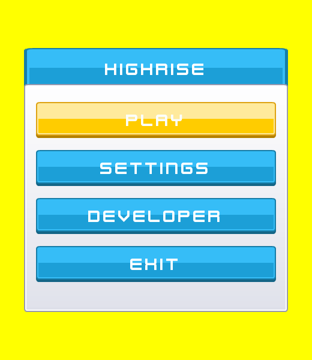 Before: Kenney Future</td>
<td>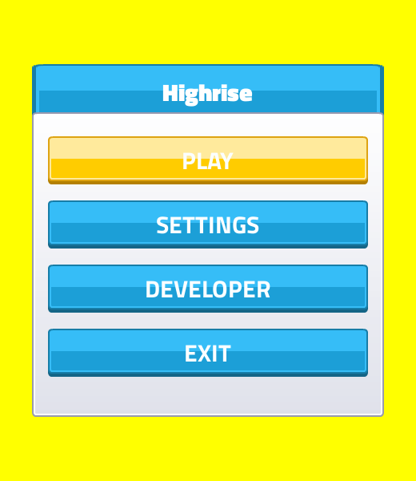 After: Titillium Web</td>
</tr>
<tr>
<td>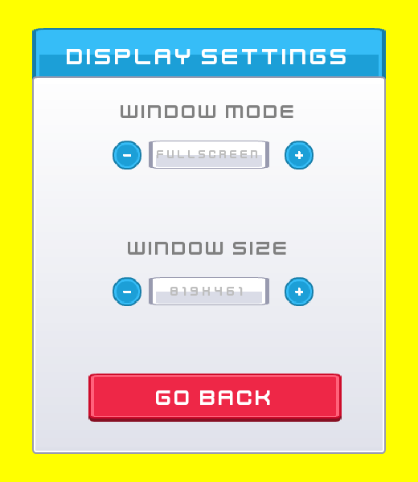</td>
<td>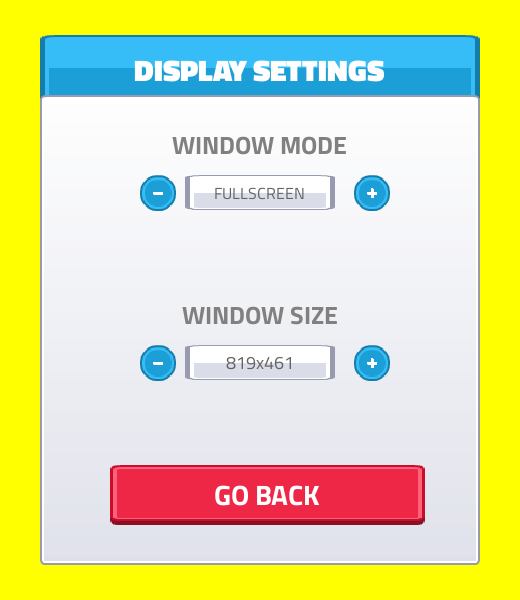</td>
</tr>
<tr>
<td>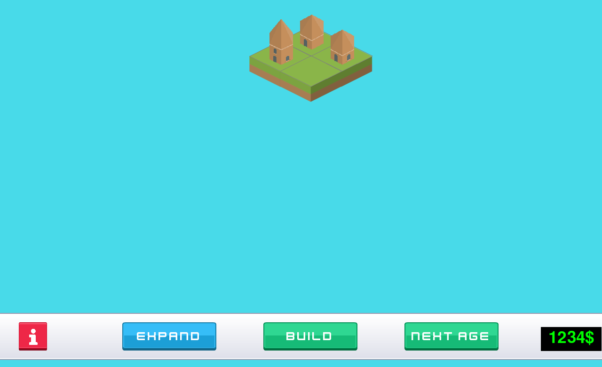</td>
<td></td>
</tr>
</table>

### Where the strings live

- **Panels:** every label in `config/panels.yaml` uses `text_key:` (and `text_params:` for the info
  panel's numbers). pygamine re-renders them when the language changes.
- **Texts inside `states:`** (the hover texts of EXPAND, BUILD, NEXT AGE and SELL) are not key-driven
  in pygamine 0.29.0. Their default text is a `text_key`; the hover texts are set from code with
  `tr()` (cost, MAX SIZE, TILES FULL, MAX AGE) and `Game` re-sets them from a
  language-changed callback, together with the window-mode label and the two new settings labels.
- **Files:** `config/lang/en.yaml` (the reference and the fallback) and `config/lang/tr.yaml`. The
  Turkish is a draft for the owner to review.

### Saving the settings

A new `settings` table (`language`, `skip_intro`) next to `game` and `buildings`, seeded with
English and "intro shown". A separate table means saves made before this change load unchanged: the
`game` table keeps its columns, and no migration runs. Both settings are saved the moment they
change (there is no Save button on that page), and starting a new game keeps them.

At launch `Game.run()` reads the settings first: the language applies before any panel is built, and
with Skip intro on the splash is dropped before it would run. An unknown saved language falls back
to English.

## Decision

The page has two stepper rows like the display settings (a label, a minus button, a value, a plus
button). Both buttons of a row do the same, because each setting has two values (the language list
wraps around, so more languages add themselves by dropping in a file).

<table>
<tr>
<td>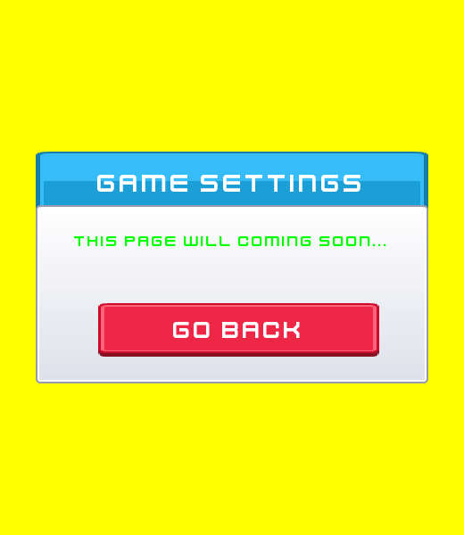 Before</td>
<td>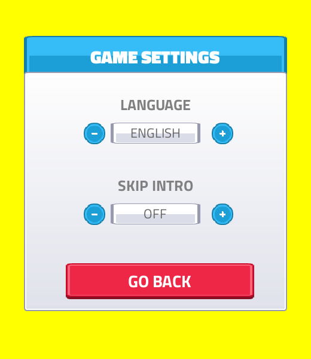 After, English</td>
<td>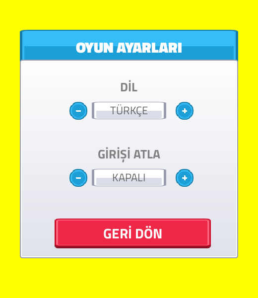 After, Türkçe</td>
</tr>
</table>

### English and Turkish side by side

<table>
<tr><td><b>English</b></td><td><b>Türkçe</b></td></tr>
<tr>
<td></td>
<td>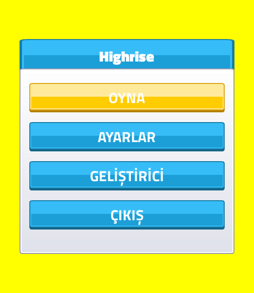</td>
</tr>
<tr>
<td>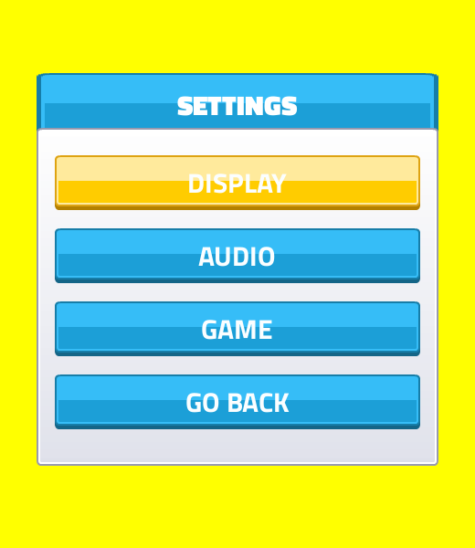</td>
<td>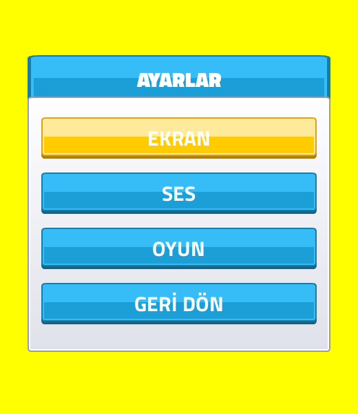</td>
</tr>
<tr>
<td></td>
<td>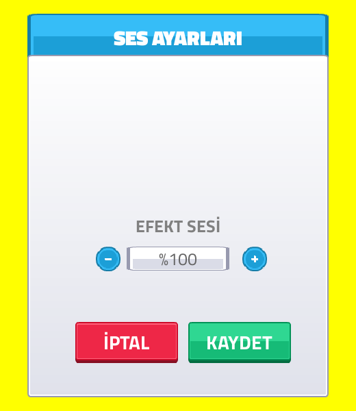</td>
</tr>
<tr>
<td></td>
<td>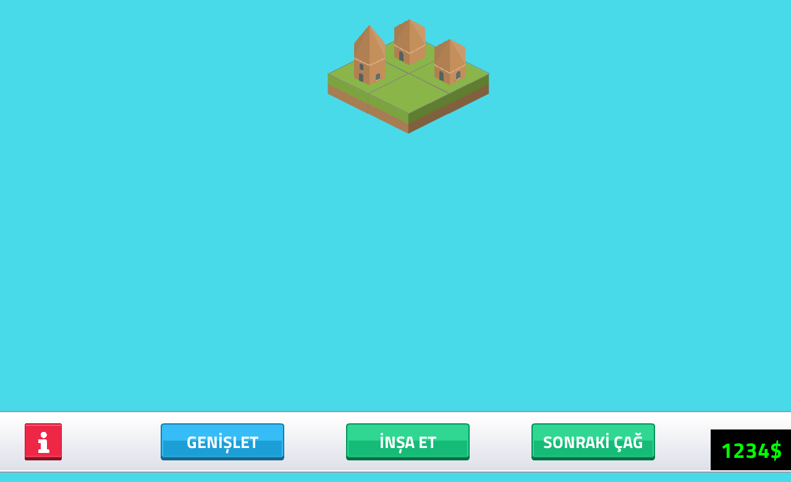</td>
</tr>
<tr>
<td> The building info panel (the game has no pause screen)</td>
<td>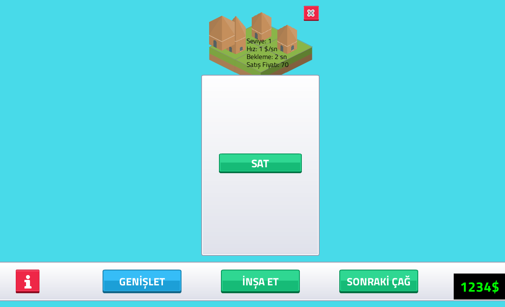</td>
</tr>
</table>

### Fit

English and Turkish were checked on every panel (screenshots above, plus `scripts/smoke_test.py`,
which now draws every panel in both languages). Every string fits at the sizes it had before. The
only visual changes:

| Where | Change | Why |
|---|---|---|
| All text | Kenney Future (Narrow) to Titillium Web: Black for titles, Bold for buttons and labels, Regular for small text | Turkish letters |
| Info panel texts (`panel_text`) | 15 to 17 | Titillium Web is smaller than Kenney Future Narrow at the same size |
| Volume, window and settings value boxes (`volume_entry_text`) | color `Gray` to `[100, 100, 100]` | The light gray was hard to read on the box; the two new value boxes need to be readable |
| Money and developer texts | `freesansbold` (a system fallback) to Titillium Bold | One font everywhere; Turkish letters |
| GAME SETTINGS panel | taller (400 px) and moved up to hold the two rows | New content |

The longest Turkish strings (GELİŞTİRİCİ, SONRAKİ ÇAĞ, PENCERE BOYUTU) fit their buttons with room
to spare.

### Checks in CI

`tests/test_localization.py` runs with the normal suite: every language has exactly the keys and
`{placeholders}` of English (and the check is shown to fail on a missing key and a changed
placeholder), and every font file in `assets/fonts/` has every character of every language.

## Rejected alternatives

- **A column on the `game` table:** needs an `ALTER TABLE` migration for existing saves; a separate
  table needs none.
- **Save and Cancel buttons on the page:** the issue wants the language applied instantly, and a
  setting you must confirm is not instant. Both settings save when they change.
- **Making `states:` texts key-driven in pygamine:** the engine is not edited by this card; the
  callback in `Game` covers the few hover texts.

## Result

The page has a working Language and Skip intro; the 40-odd strings live in `config/lang/`; the
font covers Turkish; the tests and CI cover the language files and the font glyphs.
