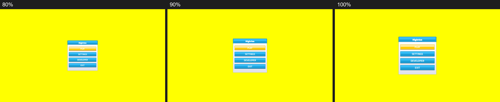
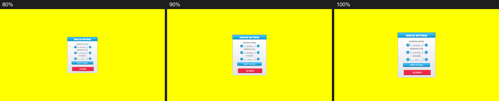
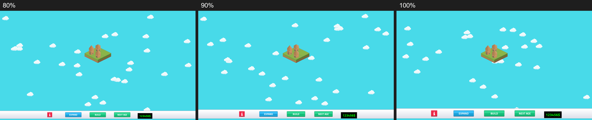

# UI scale setting
<!-- index | refs: #38, PR #41 | area: UI -->

**Date:** 2026-11-04 · **Area:** UI · **Issue:** [#38](https://github.com/vectorviolet/highrise/issues/38) · **PR:** [#41](https://github.com/vectorviolet/highrise/pull/41)

## Context

The owner finds the current UI, especially the menu widgets, too big. Chokepoint gets a UI scale
setting, and Highrise gets the same: 80 / 90 / 100 / 110 / 125 %, on the DISPLAY page, applied live
and saved. The game world (map, buildings, clouds) is not scaled.

## Options

Screenshots at 80 / 90 / 100 % (1920x1080, English), side by side:

## Decision

- **Default: pending owner.** It stays 100 % (the UI as authored) until the owner picks one from the
  screenshots. `DEFAULT_UI_SCALE` in `src/ui/ui_scale.py` is the one place to change.
- **How it is applied:** pygamine's `PanelLoader` already has a `scale` that multiplies every
  object's size, font size and offsets at load time. Changing the setting saves it, then rebuilds
  the panels with the new scale; the open panel stays open. No engine change was needed.
- **Layout anchors:** panels were authored in absolute 1920x1080 pixels, and the loader scales them
  about the window center, which keeps every centered page centered. The HUD bar was the exception:
  it would float above the bottom edge at 80 %. It now uses `anchor: bottom`, a background wider
  than any canvas, and a transparent 1920x100 `game_toolbar` that its buttons are children of, so
  the toolbar keeps its authored layout at every step.
- **Saved** in the `settings` table (`ui_scale INTEGER`, in percent), added to existing databases
  with `ALTER TABLE ... ADD COLUMN` (ADR 0002). It is saved the moment it changes.
- **Reset:** a RESET UI SCALE button on the DISPLAY page restores the default.

## Limits

- Nine-slice borders and the money label's padding are not scaled: the loader does not scale them.
  Panels look fine at every step, but the borders are relatively thicker at 80 % and thinner at 125 %.
- The reset button uses a 12 px nine-slice border, since the 20 px menu border does not fit a 44 px
  button at 80 %.

## Result

Every step works live and is saved. Tests click the real widgets at every step, at 1280x720 and
1920x1080, and check that every panel stays on screen and every text fits, in English and Turkish.
The chosen default: pending owner.
