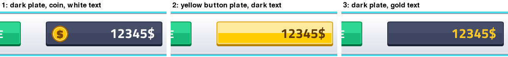
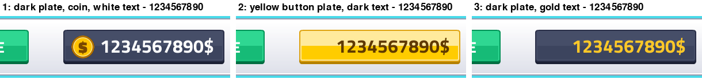
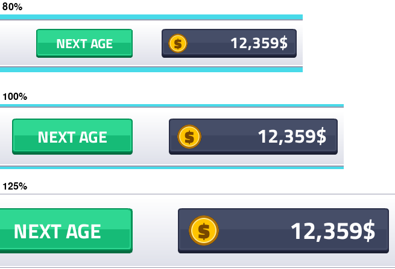
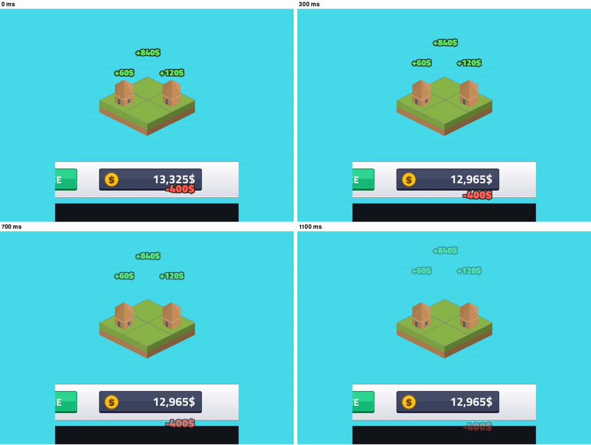
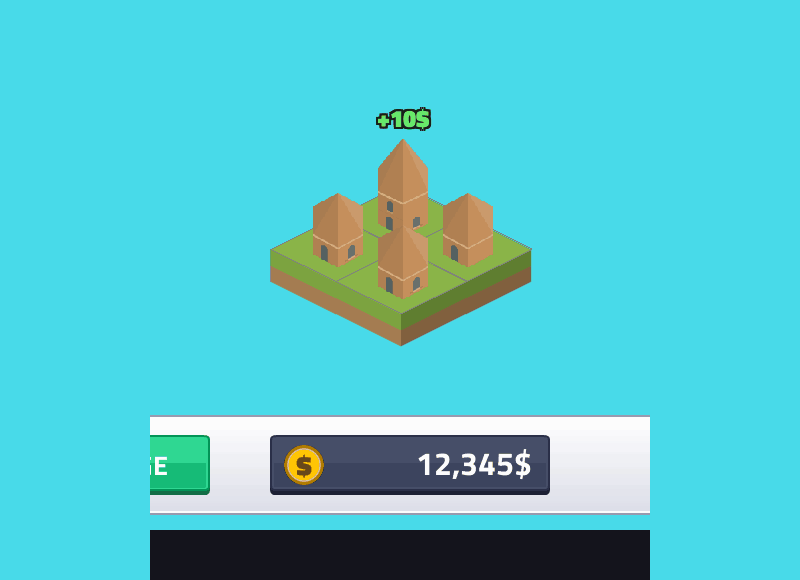
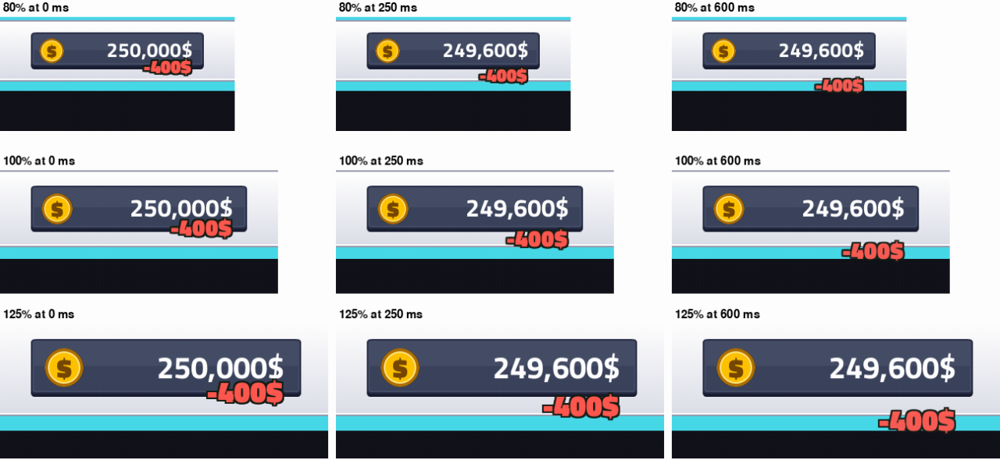
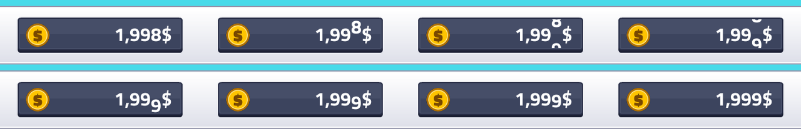
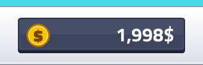

# Cash display restyle and floating money text
<!-- index | refs: #48, #50, #61, PR #54 -->

**Date:** 2026-11-10 · **Area:** UI · **Issues:** [#48](https://github.com/vectorviolet/highrise/issues/48), [#50](https://github.com/vectorviolet/highrise/issues/50), [#61](https://github.com/vectorviolet/highrise/issues/61) · **PR:** [#54](https://github.com/vectorviolet/highrise/pull/54)

## Context

The cash display was plain green text on a black box. It didn't match the Kenney UI Pack buttons
next to it, and it was taller and sat lower than them. Separately, money changes had no feedback:
payouts, sales and spending only changed the number.

## Options

### Cash display look (#48)

All three use the same plate asset family as the HUD buttons, nine-sliced to 280x60 at the buttons'
top and bottom line. The amount is right-aligned inside the plate.

*Options shown before the pick (old number format, no thousands separator).*

1. **Dark plate, coin, white text.** The UI Pack gray button plate, darkened, with a gold coin
   drawn in code (no new asset).
2. **Button-style yellow plate, dark text.** The yellow gloss plate, like the buttons' own style.
3. **Dark plate, gold text.** The same dark plate, no coin.

Ten digits still fit, in every candidate:

*Options shown before the pick (old number format).*

Alignment is checked at every UI scale (80 to 125 percent); the chosen look (candidate 1, current
number format) at 80, 100 and 125 percent:

### Floating text (#50)

Frames at 0, 300, 700 and 1100 ms: a sale (+840$) over the sold building, two payouts (+120$, +60$)
over the buildings that paid, and a spend (-400$) falling from the cash amount.

The current look: gains at 24 pt, the red text falling from the digits' baseline (it passes the
screen's bottom edge, drawn here on a dark extension), and the amount rolling to its new value.

The same, as a short GIF from the current code at 100% UI scale (3 payouts, one sale at 0.4 s and
one spend at 1.2 s; the dark band is below the real screen edge):

Neither pygamine nor Chokepoint has a reusable helper: Chokepoint's kill text lives inside its
kill-feedback class (battle time, camera, coin flight). The Highrise version is a small
self-contained class, `ui/floating_text.py`, driven by a time value passed in by the caller.

## Decision

- **Cash display look:** the owner picked candidate 1 (dark plate, gold coin, white text) after
  comparing all three in game. Candidates 2 and 3 and the `ui.cash_display` switch are removed;
  the comparison images above stay as the record of the options.
- **Alignment:** the plate and the buttons share `y: 20`, `height: 60` in `config/panels.yaml`;
  `tests/test_cash_display.py` checks top, bottom and height at every UI scale.
- **Floating text:** the numbers (colors, sizes, lifetime, rise and fall, cap) are in
  `config/settings.yaml` under `floating_text`. Text size and distances scale with the UI scale.
  Every payout gets its own text: the owner dropped the per-building merge window after
  play-testing, so there is no merge code or setting.
- **Spend text direction:** the red text starts at the bottom of the amount (the top of its
  ink at the digits' baseline, inside the plate), right-aligned with the amount, and falls down while fading, as the issue says. The cash display
  sits at the bottom screen edge, so it may fall partly off screen; the owner accepts that. (A
  first version started above the plate and fell onto it, so it stayed on screen.)
- **Payout callback:** `on_payout` now receives the building as well as the amount, so the
  floating text can find its source.

## Rejected alternatives

- A coin image from another Kenney pack: needs a new asset and license entry; a coin drawn in code
  looks right at every scale.
- Padding on the text box to make room for the coin: padding isn't scaled by the panel loader.
  The coin is its own object and the text is anchored to the plate's right edge instead.

## Result

The cash display and the floating text work at every UI scale; tests cover the amounts, signs, colors and expiry.

## Review follow-ups

- One formatter, `ui/money_format.py`, writes every amount from the language keys
  and `money.thousands`, so the cash display, the floating text and the toolbar and sell prices
  always match. The owner chose a thousands separator with the sign after the digits: "12,345$" in
  English and "12.345$" in Turkish (a dot), set per language in the lang files.
- Texts over the world are hidden while the info panel is open, so they never cover it.
- After a play-test: gain texts are smaller (24 pt, `gain_font_size`; spends stay 30 pt,
  `spend_font_size`), and the red spend text is right-aligned with the amount. Gain texts are
  clamped to the screen; the spend text is not.

The dark band is below the real screen edge (the picture is extended to show where the text
goes). The game window ends right under the HUD bar, so the text leaves the screen as it falls.

## Odometer roll for the cash amount (#61)

The cash amount rolls like an odometer: only the digits that change roll, the new digit comes in
from the bottom when money goes up and from the top when it goes down, and separators and the "$"
stay still. The owner approved the spec; the roll takes 0.25 s (`ui.cash_roll_ms`).

The GIF (slowed to 40 ms per frame) goes through 1,998 to 1,999 to 2,000 (a carry), up to 2,300,
down to 2,250 and down to 999 (a digit leaves at the left):

- `ui/odometer.py` owns the cash text and draws it one character at a time over the plate.
  `money_text` is hidden and only gives the layout (its anchored rectangle, font and color), so it
  isn't re-rendered on every change.
- Characters match from the right, so a number gaining or losing a digit rolls that digit in or out
  at its left end; a separator that goes away waits until the digits next to it have rolled out
  (no "1999$" frame), and a digit that was leaving rolls back in if the number grows again. The
  cell of a rolling digit grows or shrinks between the old and new glyph, so neighbors don't jump.
  Every digit is clipped to its own cell and to the plate. A text too wide for the room right of
  the coin ("100,000,000$" at 125%) is scaled down to fit.
- A change during a roll retargets to the newest text; nothing is queued, so the display never lags
  behind the real money. A digit already rolling toward the right character keeps its clock; one
  that changes again starts over from the character it was heading for, so a mid-roll digit can
  jump a little on a fast retarget.
- A new session and a language change show the text at once, with no roll (an open info panel's
  prices follow the language too). The format (separator,
  sign) comes from `format_money`, so the roll follows the language.
