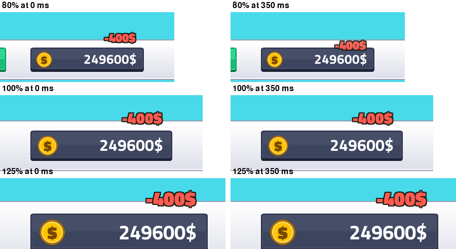

# Cash display restyle and floating money text
<!-- index | refs: #48, #50, PR #54 -->

**Date:** 2026-11-10 · **Area:** UI · **Issues:** [#48](https://github.com/vectorviolet/highrise/issues/48), [#50](https://github.com/vectorviolet/highrise/issues/50)  · **PR:** [#54](https://github.com/vectorviolet/highrise/pull/54)

## Context

The cash display was plain green text on a black box. It didn't match the Kenney UI Pack buttons
next to it, and it was taller and sat lower than them. Separately, money changes had no feedback:
payouts, sales and spending only changed the number.

## Options

### Cash display look (#48)

All three use the same plate asset family as the HUD buttons, nine-sliced to 280x60 at the buttons'
top and bottom line. The amount is right-aligned inside the plate.

1. **Dark plate, coin, white text.** The UI Pack gray button plate, darkened, with a gold coin
   drawn in code (no new asset).
2. **Button-style yellow plate, dark text.** The yellow gloss plate, like the buttons' own style.
3. **Dark plate, gold text.** The same dark plate, no coin.

Ten digits still fit, in every candidate:

Alignment is checked at every UI scale (80 to 125 percent); candidate 1 at 80, 100 and 125 percent:

### Floating text (#50)

Frames at 0, 300, 700 and 1100 ms: a sale (+840$) over the sold building, two payouts (+12$, +6$)
over the buildings that paid, and a spend (-400$) falling onto the cash display.

Neither pygamine nor Chokepoint has a reusable helper: Chokepoint's kill text lives inside its
kill-feedback class (battle time, camera, coin flight). The Highrise version is a small
self-contained class, `ui/floating_text.py`, driven by a time value passed in by the caller.

## Decision

- **Cash display look: pending owner choice.** Candidate 1 is the default for now.
  `ui.cash_display` in `config/settings.yaml` (1, 2 or 3) switches the look; the unused
  candidates are deleted from `ui/cash_display.py` once the owner picks.
- **Alignment:** the plate and the buttons share `y: 20`, `height: 60` in `config/panels.yaml`;
  `tests/test_cash_display.py` checks top, bottom and height at every UI scale and style.
- **Floating text:** the numbers (colors, lifetime, rise and fall, merge window, cap) are in
  `config/settings.yaml` under `floating_text`. Text size and distances scale with the UI scale.
  A building's payouts within the merge window of its first text add into that text.
- **Spend text direction:** the cash display sits at the bottom screen edge, so a text falling
  from it would leave the screen. The red text starts just above the plate and falls onto it,
  fading out. This is the one deviation from the issue's wording; the owner can overrule it.
- **Payout callback:** `on_payout` now receives the building as well as the amount, so the
  floating text can find its source.

## Rejected alternatives

- A coin image from another Kenney pack: needs a new asset and license entry; a coin drawn in code
  looks right at every scale.
- Padding on the text box to make room for the coin: padding isn't scaled by the panel loader.
  The coin is its own object and the text is anchored to the plate's right edge instead.

## Result

Pending the owner's pick of a candidate. The floating text and the alignment work at every UI
scale; tests cover the amounts, signs, colors, the merge window and expiry.

## Review follow-ups

- One formatter, `ui/money_format.py`, writes every amount from the `money.amount` language key
  (now `"{amount}$"`), so the cash display and the floating text always match; changing the one
  string to `"${amount}"` or `"${amount:,}"` changes both. The owner is still deciding the format.
- A sale always gets its own text; only a building's payouts merge.
- Texts over the world are hidden while the info panel is open, so they never cover it.
- After a play-test: gain texts are smaller (24 pt, `gain_font_size`; spends stay 30 pt,
  `spend_font_size`), and the red spend text is right-aligned with the amount it falls onto. Texts
  are also clamped to the screen.

