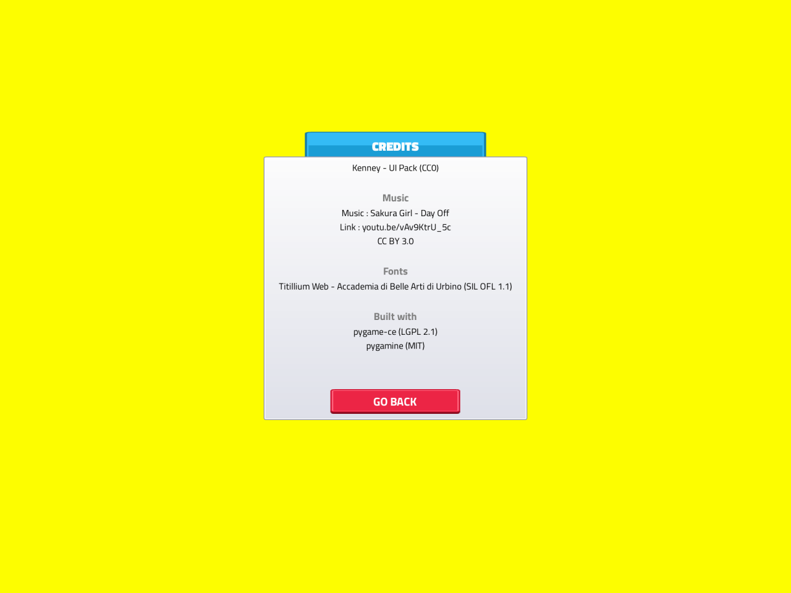
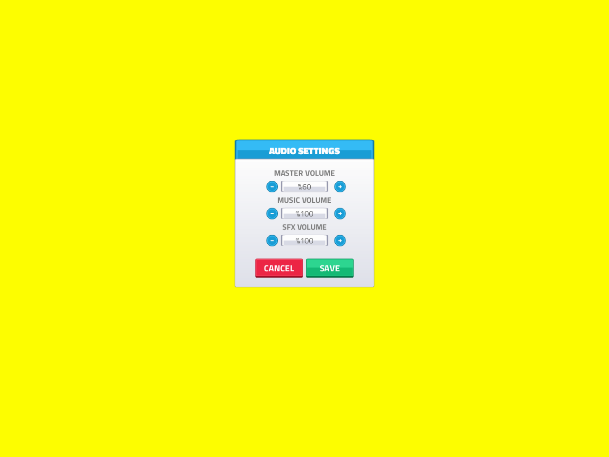
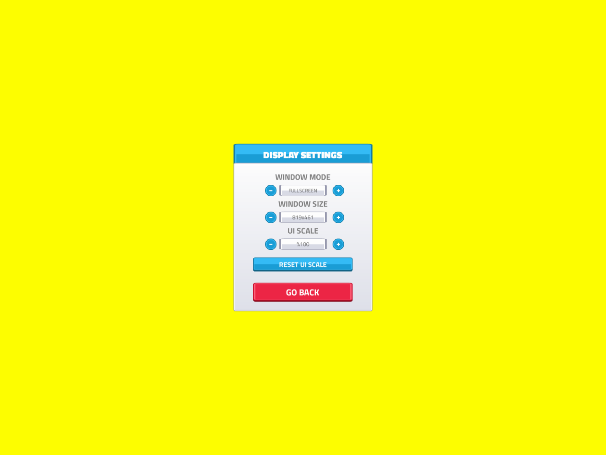
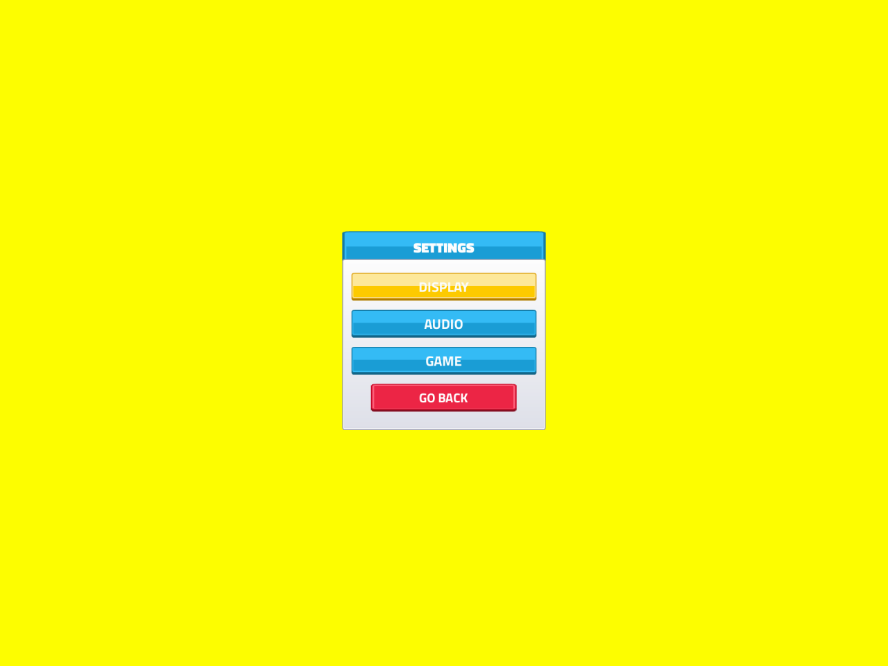

# CREDITS page and a master volume
<!-- index | refs: #46, #47, PR #49 | area: UI, Audio -->

**Date:** 2026-11-10 · **Area:** UI, Audio · **Issues:** [#46](https://github.com/vectorviolet/highrise/issues/46), [#47](https://github.com/vectorviolet/highrise/issues/47) · **PR:** [#49](https://github.com/vectorviolet/highrise/pull/49)

## Context

The main menu had a DEVELOPER page with a photo, a job title and GitHub and itch.io buttons. The
owner wants it replaced by a CREDITS page like Chokepoint's, with no social links, and wants a
MASTER VOLUME control that scales the music and every sound effect.

## Decision

- **CREDITS replaces DEVELOPER.** The menu button, the `credits` panel, its lang keys and Escape/BACK
  (to the main menu) all use the new name. Like Chokepoint's, the page scrolls its sections upward
  inside a viewport (pygamine's `scrolling_panel`) and replays from the bottom each time it opens.
  Sections: Developer, Art, UI, Sound, Music, Fonts, Built with. Every pack in `assets/SOURCES.yaml`
  appears with its license next to it; the Sakura Girl entry carries its two CC BY 3.0 attribution
  lines. `tests/test_sources.py` fails if a pack is missing from the page.
- **Removed with the developer page:** the profile photo (`cv.png`), the GitHub and itch.io icons
  and buttons, the unused `grey_button` manifest entry, the browser-opening handler, the lang keys,
  and the Trademarks section of CREDITS.md. The mouse cursor image lived in `gui/developer/`; it is
  still used, so it moved to `gui/cursor/`.
- **Master volume** is the first row of the AUDIO page, styled like the others (the page uses
  minus/plus steppers of 10 %, not sliders). It drives pygamine's `GameAudio.set_master_volume`,
  which scales the music and the SFX pool live; MUSIC VOLUME and SFX VOLUME keep showing their own values.
- **Saved in the `settings` table** (`master_volume REAL`, default 1.0), added to existing databases
  with `ALTER TABLE ... ADD COLUMN` (ADR 0002), applied at launch before the splash. The page's SAVE
  and CANCEL treat it like the other volumes. New Game keeps it, since it is a player setting and
  not part of the save.

## Result

## Play-test follow-up

The owner play-tested the PR and asked for layout changes:

- **CREDITS:** the header plate now overlaps the body panel by 10 px, like the other pages, and the
  red GO BACK button sits inside the panel at the bottom. The scrolling area is shorter to make room.
- **Every settings page:** SETTINGS, DISPLAY, AUDIO and GAME back buttons are the same red button,
  placed with `position: [CENTER, y]`. The old hard-coded x of 810 put the 315 px wide buttons about
  8 px off-center ([#60](https://github.com/vectorviolet/highrise/issues/60)); CANCEL and SAVE on
  AUDIO had the same offset as a pair. A test checks every one at every UI scale and at two window sizes.
- **AUDIO spacing:** rows now use the DISPLAY page's 85 px step and the header gap, and the panel is
  405 px high instead of 640. Without music the rows close up under a 320 px panel.

