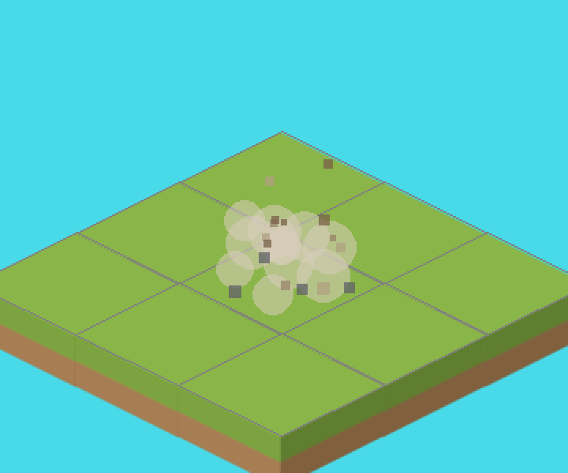
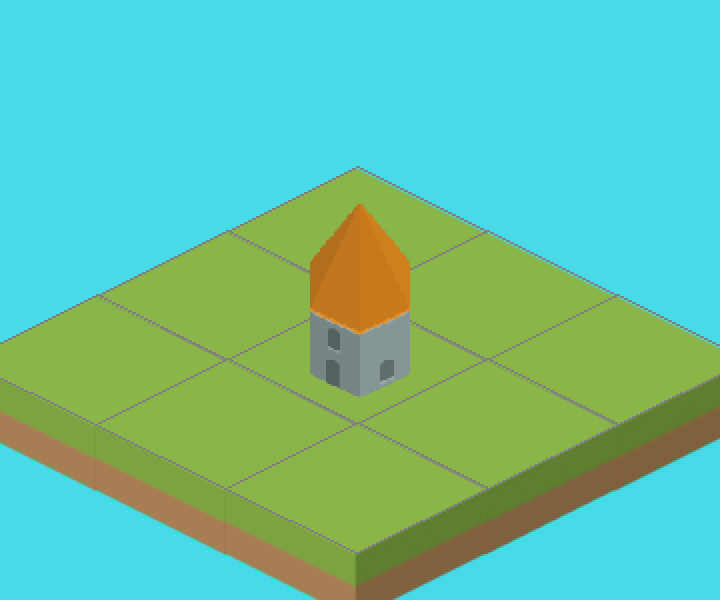

# Own sounds for build, NEXT AGE and sell, and a sell effect
<!-- index | refs: #53 -->

**Date:** 2026-11-11 · **Area:** Audio, effects · **Issues:** [#53](https://github.com/vectorviolet/highrise/issues/53)

## Context

Build, NEXT AGE and sell all played the UI click, so the three main actions sounded like opening a
menu. Selling also just removed the building with no effect. The owner asked for a construction
sound per age, a NEXT AGE sound, a destroy sound and a dust effect on a sale, all on free SFX
channels and following the master and SFX volumes.

## Options

### Sounds

All candidates are Kenney CC0 packs from the asset library. Chosen files are the defaults; the
others stay candidates for the owner.

- **Build, one per age** (Impact Sounds): wood `impactPlank_medium_000`, rock `impactMining_000`,
  sand `impactSoft_heavy_000`, stone `impactPlate_heavy_000`. Alternatives: `impactWood_*`,
  `impactMetal_*`, `footstep_*`, any of the `_001` to `_004` takes.
- **NEXT AGE** (Interface Sounds): `maximize_005`, the longest rising one. Alternatives:
  `confirmation_001` to `confirmation_004`, `maximize_004`.
- **Sell** (Sci-Fi Sounds): `explosionCrunch_000`, a short crunch. Alternatives:
  `explosionCrunch_001` to `_004`, `lowFrequency_explosion_000`, Impact Sounds `impactWood_heavy_*`.

### Effect

Dust and debris, drawn in code (no sprites, so no new image asset): soft growing puffs that drift
up and fade, and small chips that fly out and fall. Candidates were a smoke sprite animation
(Kenney Smoke Particles) and code-drawn particles; particles won because they need no asset, scale
with the numbers in config and cost nothing per frame beyond the burst's life.

## Decision

- `action_sounds` in `config/settings.yaml` names a manifest sound for each build age, NEXT AGE and
  sell, so a sound can be swapped (or all ages given one sound) without code. `app/action_sounds.py`
  looks them up and rejects a missing age.
- They play through `GameAudio.play_sfx`: a free pool channel at master times SFX volume, never the
  music or a reserved channel. The sell button no longer plays the click.
- `ui/dust_effect.py` makes each burst's particles once, fixes their paths at spawn, and draws
  cached circle and square pictures per size and opacity step, so a frame allocates no surface.
  Numbers are in `sell_effect` in `config/settings.yaml`, checked when the config loads. The effect is
  a world object of the game panel (with the tiles and buildings), so the HUD and panels stay on top.

## Result

Three Kenney packs (Impact, Interface, Sci-Fi Sounds) join the credits page. Tests cover the
lookup per action and age, the volume routing, and the effect's spawn, end and removal.
