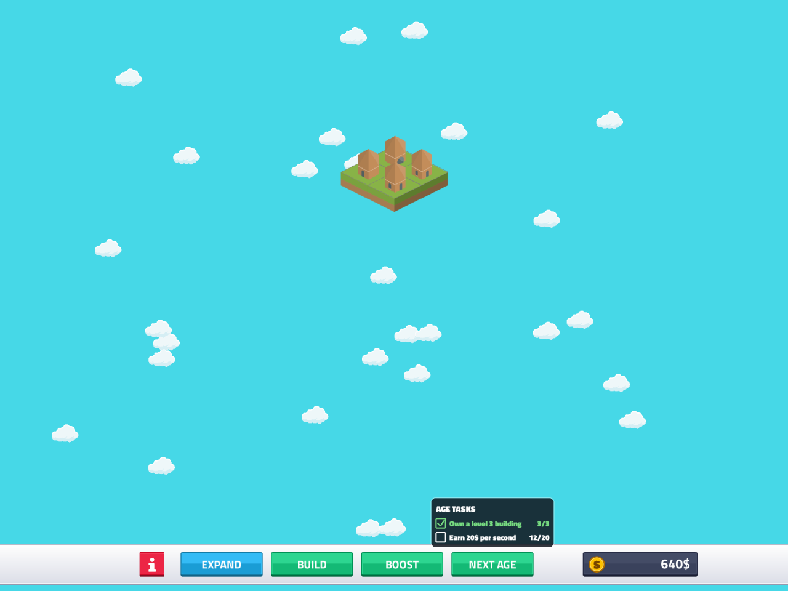
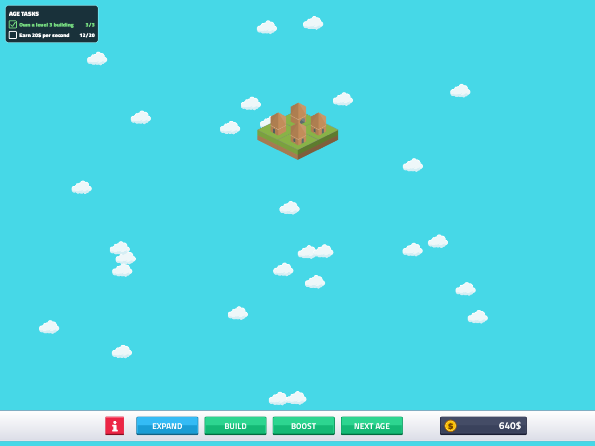

# Age tasks
<!-- index | refs: #52, #51, PR #77 | area: Gameplay, UI -->

**Date:** 2026-11-11 · **Area:** Gameplay, UI · **Issue:** [#52](https://github.com/vectorviolet/highrise/issues/52)  · **PR:** [#77](https://github.com/vectorviolet/highrise/pull/77)

## Context

NEXT AGE only cost money, so the player could rush through the four ages without ever using
merging or boosters. The owner wants each age to ask for something first, and wants the BOOST
button (#51) to stay locked until the player has shown they can play the first age.

## Rules (owner's spec, 2026-11-11)

- Every age but the last has 2 or 3 tasks, written in `config/tasks.yaml`. Three kinds:
  - `building_level`: own a building of level N or higher,
  - `income_per_second`: earn N $ per second (every building's speed times its booster multiplier, right now),
  - `boosted_buildings`: have N buildings standing on tiles a booster covers (boosters themselves don't count).
- Wood (age 1): own a level 3 building, earn 20 $/sec. Rock and sand mix all three kinds. All
  numbers are placeholders for the owner to tune.
- Finishing the wood tasks unlocks BOOST for good. Until then the button's hover text says
  LOCKED (KİLİTLİ) instead of a price, and clicking it does nothing. NEXT AGE's hover text shows
  LOCKED the same way while its tasks are open (so panel mode says why a click does nothing).
- NEXT AGE needs all of the current age's tasks done **and** (age number + 1) x 500 $ (age number
  counting from 0, so wood to rock costs 500). The factor 500 is `next_age_cost_factor` in
  `config/tasks.yaml`; it replaces the old `Buildings.get_age_cost` (x 1000). A refused NEXT AGE
  (tasks missing or cash missing) costs nothing and plays nothing.
- A task, once done, stays done (it is latched): selling or merging away the building afterwards
  does not undo it. The done tasks and the BOOST unlock are saved in a new `tasks` table.
- A new age starts with all its tasks open.

## Old saves

A save from before this change has no task state. Its current age's tasks start fresh (nothing
done), and BOOST is unlocked when the save is already past age 1 (wood). A save still in wood has
BOOST locked until the tasks are done. New Game resets everything (first age, BOOST locked).

## Options: where the progress shows

The owner wanted both built and will pick one. `ui` in `config/tasks.yaml` switches them
(`hover` by default); the two modes are separate small methods in `Game`
(`_draw_task_hover`, `_draw_task_panel`) over one shared painter (`ui/task_list.py`), so the
loser is a small delete. Each row has a check box (ticked and green when done), the task text and
its progress ("12/20"). Screenshots are mid-progress: one building of level 3 and 12 $/sec.

**A, hover (default):** a checklist over NEXT AGE while the mouse is on that button.

**B, panel:** a small panel at the top left, always visible.

| | A: hover | B: panel |
|---|---|---|
| Screen space | none until hovered | a corner is always taken |
| Progress visible | only when asked | all the time, so goals guide play |
| Discoverable | the player must know to hover | obvious |

## Decision

Pending: the owner picks A or B. The other mode is then removed in a follow-up commit.

## Notes

- **Where the state lives:** `gameplay/tasks.py` (`AgeTasks`, `TasksConfig`, `Task`) holds the
  logic and no UI; `Game` checks the tasks every frame (`_update_tasks`) and in `next_age`, so the
  gate never reads a stale answer. The class attribute `Game.boosters_unlocked` is gone;
  `Game.tasks.boost_unlocked` is the one switch.
- **One age:** `AgeTasks` reads `Buildings.age_number` and keys done tasks by age, so a new age
  has its tasks open with no manual sync. Targets that can never be met (a building level above the
  maximum, more boosted buildings than the biggest board holds) are refused when the config loads.
  In panel mode the checklist swallows mouse clicks, like the info panel.
- **The last age has no tasks** (there is no NEXT AGE from it), so the checklist is hidden there.
- **No check mark glyph:** the font has none, so the check box is drawn with shapes.
- **Rejected:** storing the task state in the `game` table (its columns are read by position, and
  a separate table keeps older saves loading unchanged, like `settings`).

## Result

Pending the owner's pick and play-test.
