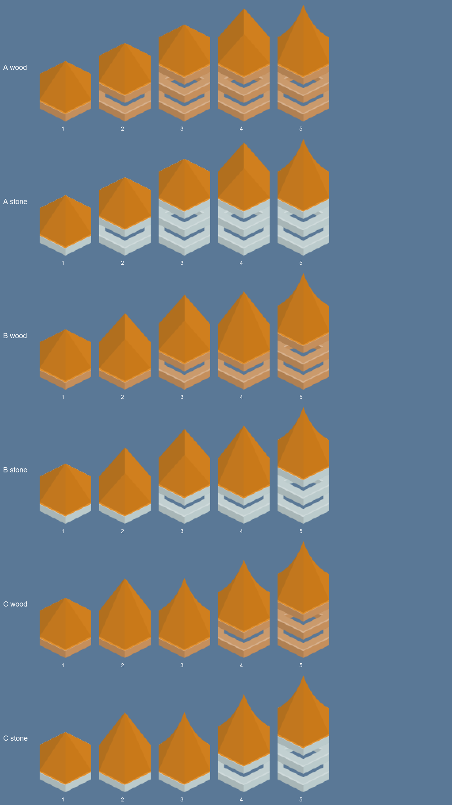
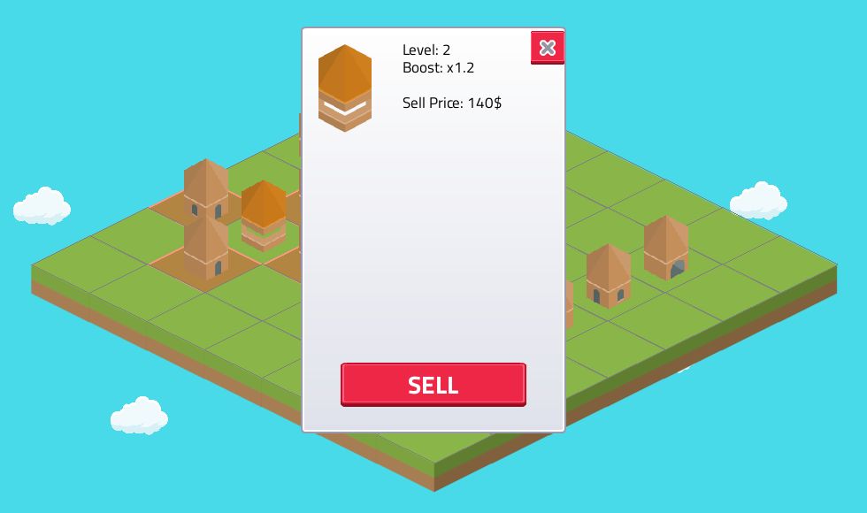
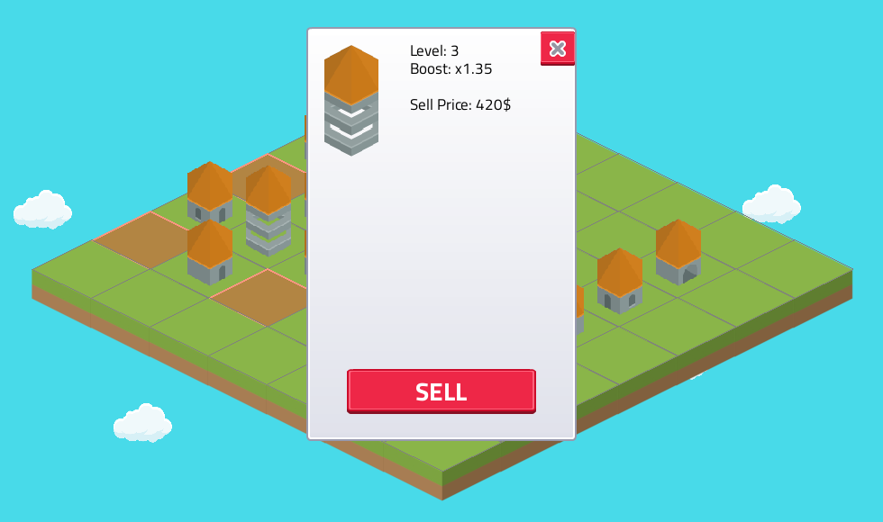
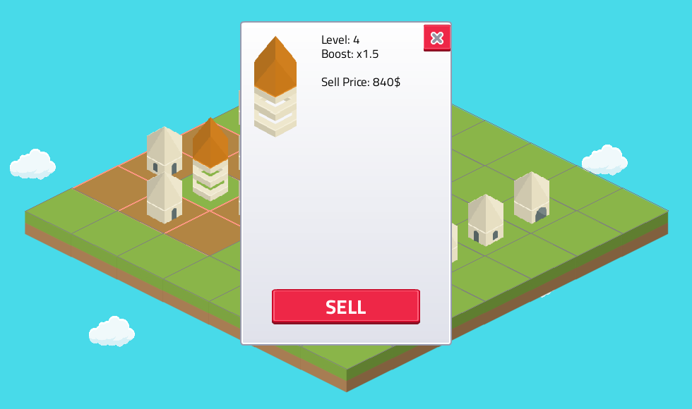
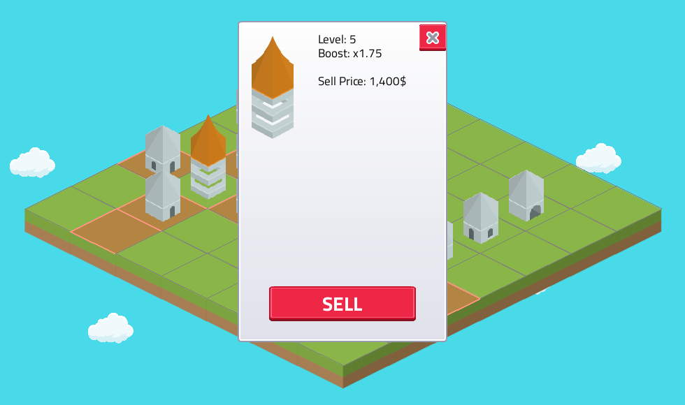

# Booster buildings
<!-- index | refs: #51, #10, #52, #59 | area: Buildings -->

**Date:** 2026-11-11 · **Area:** Buildings · **Issue:** [#51](https://github.com/vectorviolet/highrise/issues/51)

## Context

Merging only ever made one building stronger. Boosters add a second thing to plan around: a
building that earns nothing itself but raises the income of the tiles near it, so where the
buildings sit (and slide to) matters, not only how high they are. The owner fixed the rules in the
issue; this entry records how they were built and what was still open.

## Rules (owner's decisions)

- A booster earns nothing. The boost belongs to the **tile**: any building on a covered tile earns
  more, and sliding in or out of range changes its income at once.
- Coverage by age: wood the 4 orthogonal neighbors, rock the 4 diagonals, sand all 8 surrounding
  tiles, stone its whole row and column. A booster never covers its own tile.
- A separate **BOOST** button next to BUILD puts a level 1 booster of the current age on a random
  empty tile (same flow as BUILD: spend, sound, nothing happens on a full board). Available from the
  start; a quest unlock comes later (#52): `Game.boosters_unlocked` is the one switch.
- Boosters slide with every building and merge only with a booster of the same type and level; they
  never merge with normal buildings. Five levels. On NEXT AGE a booster becomes the new age's type
  (its shape changes), like a normal building.
- Saved with the game; old saves have no boosters.

## Options: the look

Built from the pack's hex **ring** piece with a red roof (`redRoof*`), as recipes in
`config/buildings.yaml` (not the gate: since #59 the wide gate marks building levels 3 and up).
The ring is a hollow floor 13 px shorter than a full floor, so `compose` keeps every floor piece's
foot on the same line. Three ladders of five levels, wood and stone shown (rock and sand differ
only in the ring color):

- **A (in the game):** more rings first (1, 2, 3), then the roof grows (low, pointed, curved
  spire). Every level adds one clear change and the sprite grows every level.
- **B:** the roof rises first (low, pointed), rings and a taller roof follow.
- **C:** the curved spire arrives at level 3, then rings. Level 3 is shorter than level 2, so it
  reads as a step back.

Render them with `scripts/render_building_styles.py --boosters`.

In the game, with the booster's info panel open (rock: its diagonals; wood: its 4 neighbors; sand: all 8 around it; stone: its whole row and column):

## Decision

Placeholders (the owner balances them in #10; all in `boosters` in `config/settings.yaml`):

| Level | Multiplier |
|---|---|
| 1 | x1.1 |
| 2 | x1.2 |
| 3 | x1.35 |
| 4 | x1.5 |
| 5 | x1.75 |

BOOST costs 250 / 500 / 750 / 1000 in wood / rock / sand / stone. A booster sells for the same
formula as a building (`level * (age + 1) * 70`).

- **Overlap adds the bonus part:** x1.1 and x1.2 make x1.3 (0.1 + 0.2 on top of 1), not x1.32.
  A placeholder rule. Both sit in `Buildings.income_multiplier`.
- **Fractions are kept.** A level 1 wood building pays 2$; at x1.2 that is 2.4$. Rounding each
  payout would erase small boosts, so a building carries the cents it could not pay and pays them
  with a later payout (2, 2, 3, 2, 3 ...).
- **Where the multiplier is applied:** `Game._on_building_payout`, the one place every payout
  passes. A booster is a `Building` with a `booster_multiplier` (None for a normal building) and no
  payout callback; `Buildings` owns coverage, merging and the multiplier.
- **Highlight:** the tiles a selected booster covers get a translucent red wash with a lighter
  outline (the roof color), drawn over the ground while its info panel is open (`Tile.highlighted`,
  set each frame by `Game`). The info panel shows the booster's level and multiplier instead of
  speed and cooldown.
- **Saves:** a `booster` column in `buildings` (old tables are migrated, every old row is a plain
  building).
- BOOST is green (a build action) in the menu button colors.

## Rejected alternatives

- **Boosters that earn too:** the owner wants a trade-off against a normal building.
- **A boost that stays with the building:** the owner's rule is the tile, so sliding matters.
- **Multiplying overlaps (x1.1 times x1.2):** grows too fast with many boosters.
- **The gate piece:** it marks building levels.

## Result

The board has a second kind of piece that is read at a glance (ring and red roof) and rewards
planning. Open: the info panel covers the middle of the board, so the highlight shows mostly at its
edges (see the owner questions in the PR).
