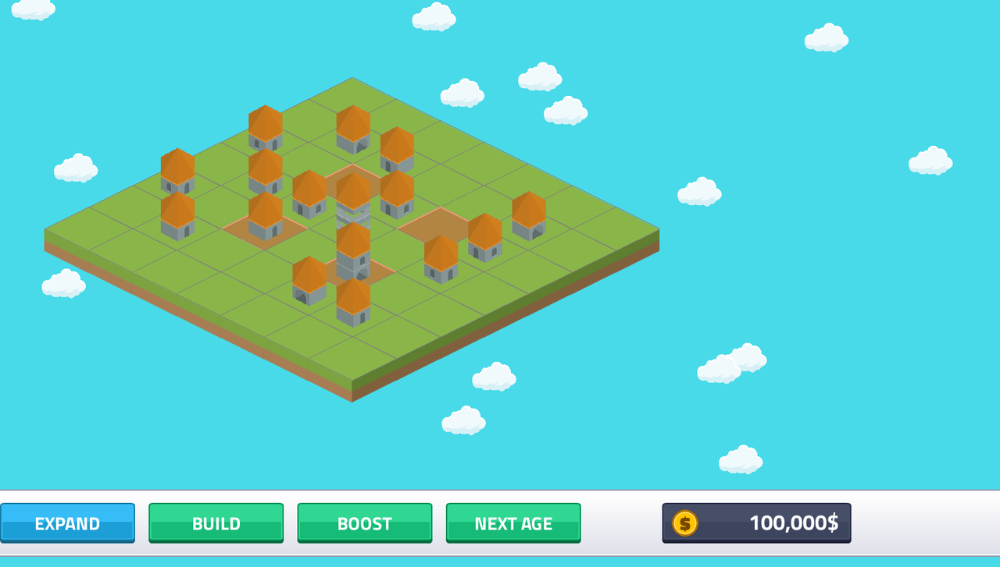

# Booster buildings
<!-- index | refs: #51, #10, #52, #59, PR #73 | area: Buildings -->

**Date:** 2026-11-11 · **Area:** Buildings · **Issue:** [#51](https://github.com/vectorviolet/highrise/issues/51)  · **PR:** [#73](https://github.com/vectorviolet/highrise/pull/73)

## Context

Merging only ever made one building stronger. Boosters add a second thing to plan around: a
building that earns nothing itself but raises the income of the tiles near it, so where the
buildings sit (and slide to) matters, not only how high they are. The owner fixed the rules in the
issue; this entry records how they were built and what was still open.

## Rules (owner's decisions, issue #51 comments of 2026-11-11)

- A booster earns nothing. The boost belongs to the **tile**: any building on a covered tile earns
  more, and sliding in or out of range changes its income at once.
- Coverage by age: wood the 4 orthogonal neighbors, rock the 4 diagonals, sand all 8 surrounding
  tiles, stone its whole row and column. A booster never covers its own tile.
- A separate **BOOST** button next to BUILD puts a level 1 booster of the current age on a random
  empty tile (same flow as BUILD: spend, sound, nothing happens on a full board). Available from the
  start; a quest unlock comes later (#52): `Game.boosters_unlocked` is the one switch.
- Boosters slide with every building and merge only with a booster of the same type and level; they
  never merge with normal buildings. Five levels. On NEXT AGE a booster becomes the new age's type
  (its shape changes), like a normal building.
- Saved with the game; old saves have no boosters.

## Options: the look

Built from the pack's hex **ring** piece with a red roof (`redRoof*`), as recipes in
`config/buildings.yaml` (not the gate: since #59 the wide gate marks building levels 3 and up).
The ring is a hollow floor 13 px shorter than a full floor, so `compose` keeps every floor piece's
foot on the same line. Three ladders of five levels, wood and stone shown (rock and sand differ
only in the ring color):

- **A (in the game):** more rings first (1, 2, 3), then the roof grows (low, pointed, curved
  spire). Every level adds one clear change and the sprite grows every level.
- **B:** the roof rises first (low, pointed), rings and a taller roof follow.
- **C:** the curved spire arrives at level 3, then rings. Level 3 is shorter than level 2, so it
  reads as a step back.

Render them with `scripts/render_building_styles.py --boosters`.

In the game (wood: the 4 neighbors, stone: its whole row and column). The info panel is at the
window's right edge, so the covered tiles stay visible:

Hovering a booster with the mouse (no panel open) lights the same tiles (rock: its diagonals):

## Decision

Placeholders (the owner balances them in #10; all in `boosters` in `config/settings.yaml`):

| Level | Multiplier |
|---|---|
| 1 | x1.1 |
| 2 | x1.2 |
| 3 | x1.35 |
| 4 | x1.5 |
| 5 | x1.75 |

BOOST costs 250 / 500 / 750 / 1000 in wood / rock / sand / stone. A booster sells for the same
formula as a building (`level * (age + 1) * 70`).

- **Overlap adds the bonus part:** x1.1 and x1.2 make x1.3 (0.1 + 0.2 on top of 1), not x1.32.
  A placeholder rule. Both sit in `Buildings.income_multiplier`.
- **Fractions are kept, and saved** (`buildings.income_fraction`, 0 for old rows; always under 1$: a merge of two buildings pays the whole dollar of their fractions at once, with its "+1$" text). A level 1 wood building pays 2$; at x1.2 that is 2.4$. Rounding each
  payout would erase small boosts, so a building carries the cents it could not pay and pays them
  with a later payout (2, 2, 3, 2, 3 ...).
- **Where the multiplier is applied:** `Game._on_building_payout`, the one place every payout
  passes. A booster is a `Building` with a `booster_multiplier` (None for a normal building) and no
  payout callback; `Buildings` owns coverage, merging and the multiplier.
- **Highlight:** the tiles a booster covers get a translucent red wash with a lighter outline (the
  roof color), drawn over the ground (`Tile.highlighted`) while its info panel is open or the mouse
  is over it (its sprite or its tile; the open panel wins). `Game` keeps the booster it lit and walks
  the tiles only when that booster, its tile or age, or the board changes. The info panel shows the
  booster's level and multiplier instead of speed and cooldown.
- **Info panel moved to the right edge (owner's decision, for every building):** the centered panel
  hid the middle of the board, and with it most of a booster's highlight. It is now anchored to the
  window's right edge (60 px in) and vertically centered, its content parented to it, so it scales
  with the UI scale and stays on screen and clear of the bottom bar (`tests/test_info_panel_layout.py`
  checks every scale). Rejected: only the hover highlight (the panel would still hide the board), and
  only moving the panel (the hover is the quicker way to read a booster).
- **A booster you just placed** stays lit for 1.5 s (`boosters.placed_highlight_ms`), because the mouse
  is on the toolbar at that moment; the open panel and the hover take over at once.
- **Saves:** a `booster` column in `buildings` (old tables are migrated, every old row is a plain
  building).
- BOOST is green (a build action) in the menu button colors.

- **Switching the open panel (owner's feedback):** with the panel open, a click on another building in
  selection mode shows that building in the panel (content, image, highlight, SELL target) instead of
  being ignored. The panel was modal in the event routing (`_handle_info_panel_event` only knew SELL
  and close). A click on the panel itself never reaches the board behind it, and a click on an empty
  tile changes nothing. The panel is not draggable.

## Rejected alternatives

- **Boosters that earn too:** the owner wants a trade-off against a normal building.
- **A boost that stays with the building:** the owner's rule is the tile, so sliding matters.
- **Multiplying overlaps (x1.1 times x1.2):** grows too fast with many boosters.
- **The gate piece:** it marks building levels.

## Result

The board has a second kind of piece that is read at a glance (ring and red roof) and rewards
planning. The owner approved look A, the green BOOST button, the Turkish texts (GÜÇLENDİR,
"Artış: x{value}", decimal comma), the toolbar spacing and the sell price formula.
