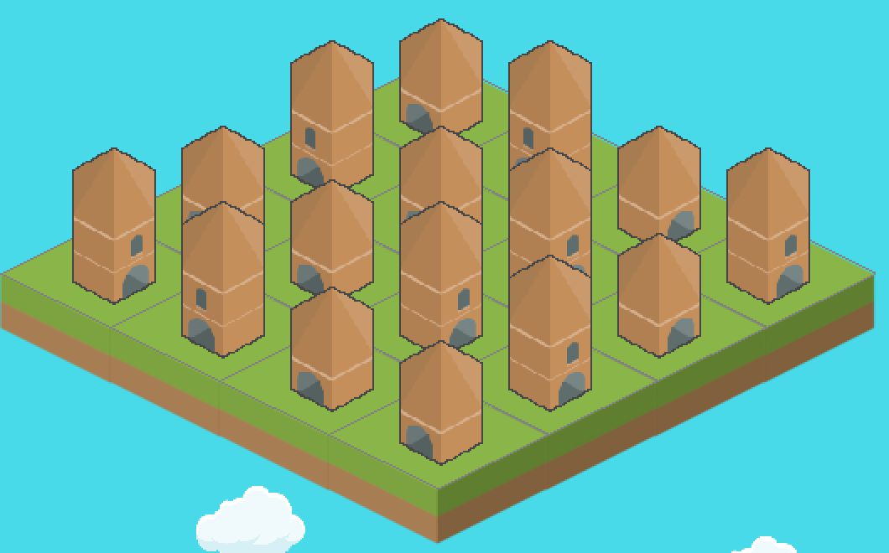
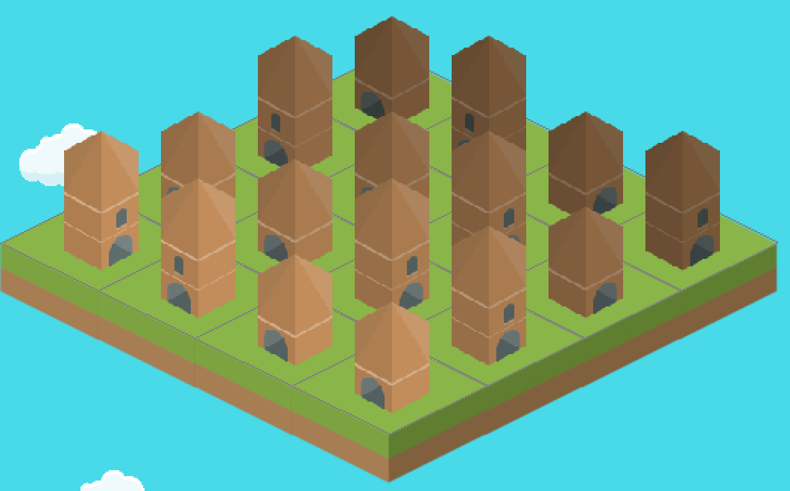

# Building outline
<!-- index | refs: #75 | area: Buildings -->

**Date:** 2026-11-11 · **Area:** Buildings · **Issue:** [#75](https://github.com/vectorviolet/highrise/issues/75)

## Context

Buildings of the same age and similar levels, stacked on neighboring tiles, blend into one block:
the Kenney pieces have no strong edge of their own, so where one roof ends and the next wall
begins is hard to see. Same board, before and after the change (a 4x4 wood board, levels 3 and 4):

| Before: no outline | After: option a |
|---|---|
|  |  |

## Options

- **a: a thin outline in a darker shade of the building's own colors.** Still looks like part of the
  Kenney art.
- **b:** a dark-gray outline on every building. Too heavy and cartoony.
- **c:** no outline, darker back rows. Two buildings in the same row still blend.

Mock-ups of the two rejected options on the same board (rendered for this entry, never in the game):

| b (mock-up): gray outline | c (mock-up): darker back rows |
|---|---|
|  |  |

## Decision

Option **a** (owner's decision, 2026-11-11). No comparison step was built.

The "After" picture above is the result.

- **Follows the alpha silhouette.** The outline is the outermost `width` pixels of the sprite as it
  is drawn (alpha 128 or more counts as solid, the soft scaled edge below that is darkened too).
  Each such pixel keeps its alpha and gets its own color times `darken`, so wood stays brown, not
  gray.
- **Drawn inside the surface.** The composed sprite already touches its surface edge on the sides
  and the foot, so an outline on the transparent pixels around it would need a bigger surface,
  which moves the foot and the click area (both come from the surface size). Recoloring the
  silhouette's own rim changes no size, no alpha and no anchor; a test checks the alpha mask is
  identical.
- **Fast.** The rim comes from `pygame.mask` operations and one masked blit, about 0.04 ms per
  sprite against 4 ms for a first per-pixel version (all 64 world sprites: 3 ms against 257 ms).
- **Once per sprite.** `game_sprite` and `panel_sprite` outline the scaled sprite when they build it
  and cache the result with it; `compose` stays un-outlined (the devlog render script uses it). No
  per-frame work.
- **Defaults:** `outline: {width: 1, darken: 0.55}` in `config/buildings.yaml` (width in screen
  pixels, 0 turns it off). The owner checks the width and darkness on the PR.
- Applies to normal buildings and boosters, on the board and in the info panel.

## Result

Every building reads on its own in a crowded board; the info panel's enlarged sprite gets the same
outline.
