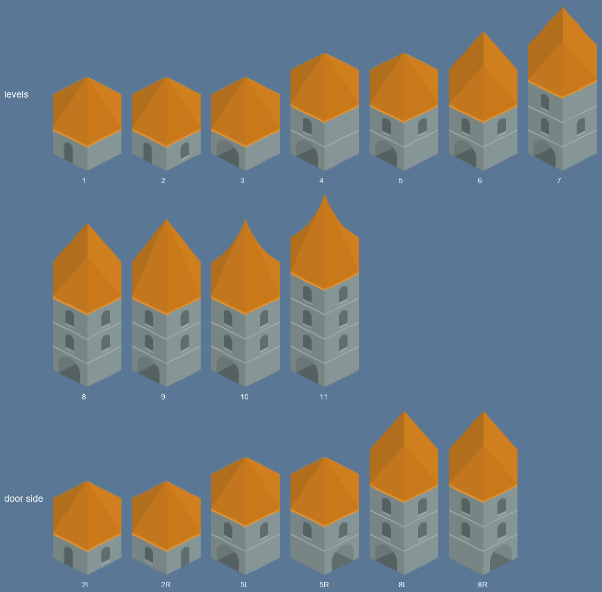
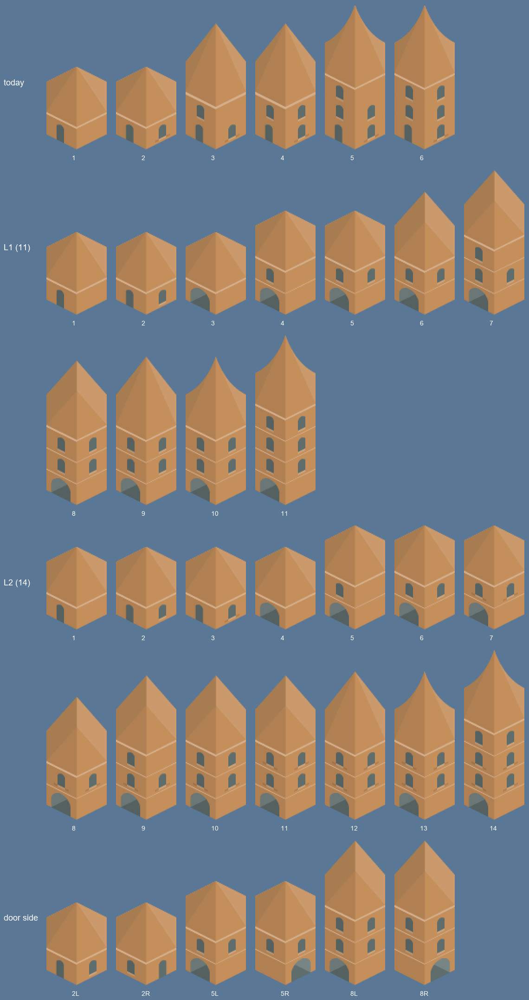
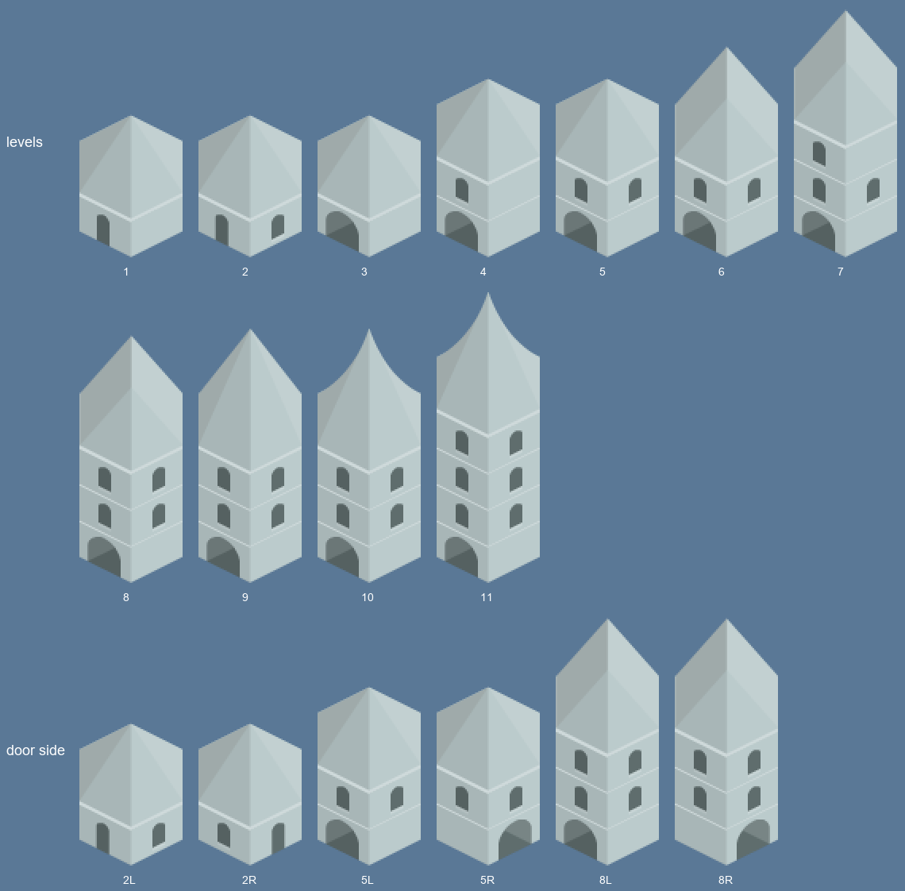
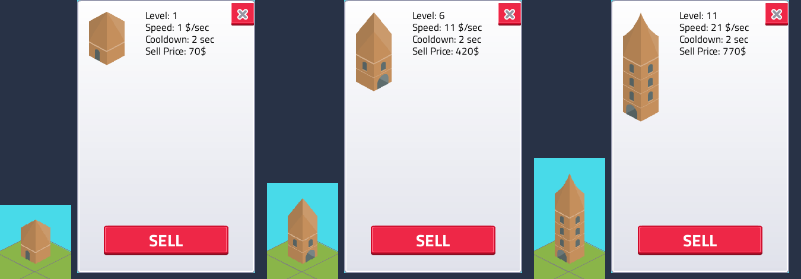
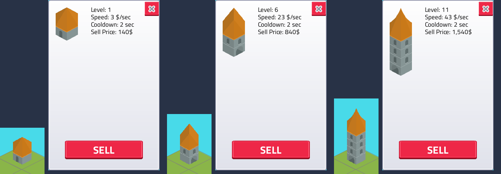

# Building recipes
<!-- index | refs: #59, #72, PR #71 | area: Buildings -->

**Date:** 2026-11-11 · **Area:** Buildings · **Issues:** [#59](https://github.com/vectorviolet/highrise/issues/59)

## Context

The building sprites were hand-made composites of the Kenney Hexagon Buildings pieces, six levels
that looked like three (levels 1 and 2, 3 and 4, 5 and 6 were identical), every base level with the
door on the left. An incremental game has to grow past six levels, and every level should be
readable at a glance. The sprites are now composed in code from the raw pieces by recipes in
`config/buildings.yaml`.

## Options

Round 1 compared today's sprites with two recipe styles: A (close to today, blinds to tell even
levels apart) and B (random gates, windows and roofs per building). Owner feedback: the only
per-building variety is the door side, and every level must add exactly one visible change, with
more than six levels.

Round 2 compared two ladders, both with the door as the only variety:

- **L1, shutters reserved (11 levels):** doors, door+window, gates, window floors and roof shapes.
- **L2, shutters used (14 levels):** the same plus shutter pieces as level steps.

L1 on rock (levels 1 to 11, and a door-left / door-right pair for levels 2, 5 and 8):

What each level adds (L1):

| Level | Change |
|---|---|
| 1 | a plain door under a low roof |
| 2 | a window beside the door |
| 3 | the door becomes a wide gate |
| 4 | a second floor with a window |
| 5 | the second floor gets a second window |
| 6 | the roof rises to a point |
| 7 | a third floor with a window |
| 8 | the third floor gets a second window |
| 9 | the roof grows taller |
| 10 | the roof becomes a curved spire |
| 11 | a fourth floor |

## Decision

**L1** (owner's pick). Readability: one visible change per level, no two levels alike, and the
height grows every few levels. Shutters stay free as a separate per-building renovation upgrade
([#72](https://github.com/vectorviolet/highrise/issues/72)). Door side is random when a building is
built, saved with it, kept through every level and age change, and a merge keeps the side of the
building that stays in place.

How a sprite is composed: the ground floor piece (65x89) at the bottom, each further floor 23 px
higher (the game's own floor step), the roof aligned so its base lands on the top floor's top edge.
A one-floor sprite is drawn 50x75 in the world as before; taller sprites use the same scale
factors, so the foot stays 52 px below the tile top and buildings grow upward. Sprites are cached
per (age, level, door side). A sprite is as wide as its widest piece (the sand and stone straight
roofs are one pixel wider than the floors) with pieces centered, and each age aligns its roof by its
own `roof_base` (the sand and stone roofs are a pixel taller), so a one-floor sprite is 50x75 in
every age.

The info panel shows the same building as the board: same pieces, door side and proportions, at one
fixed scale (1.2x) for every level, roof tip at the top of the box (the same line as the first text line), so level growth shows there too.
Its box in `config/panels.yaml` is 60x185, top-aligned with the first text line just under the panel top (the tallest sprite, level 11, is 154 px in the world and
fits at 1.2x); the image scales with the UI scale. Left to right for each level: the board, then
the open info panel.

Levels 7 to 11 use the same income (`speed = level * 2 * (age + 1) - 1`) and sell price
(`level * (age + 1) * 70`) formulas as levels 1 to 6; these are placeholders for the owner's
balance pass.

## Rejected alternatives

- **Style A** (levels in lookalike pairs, blinds to tell even levels apart): not readable at a
  glance.
- **Style B** (random gates, windows and roofs per building): the owner wants the door side to be
  the only variety.
- **L2** (shutters as level steps): shutters are nearly invisible on the wood and stone pieces, and
  they are reserved for #72.
- **Seamless floors:** the floor seam lines are the light top edge of each pack floor piece and the
  pack has no plain wall piece, so removing them would mean editing the art. They stay.

## Result

`assets/images/buildings/` holds the 52 pack pieces the recipes use (all four ages: nine floor
pieces and four roofs each; rock wears the pack's red roofs), listed in `assets/SOURCES.yaml`; the 24
hand-made PNGs are gone. `max_building_level` is 11. `scripts/render_building_styles.py` renders
the sheets above from the game's own code.
