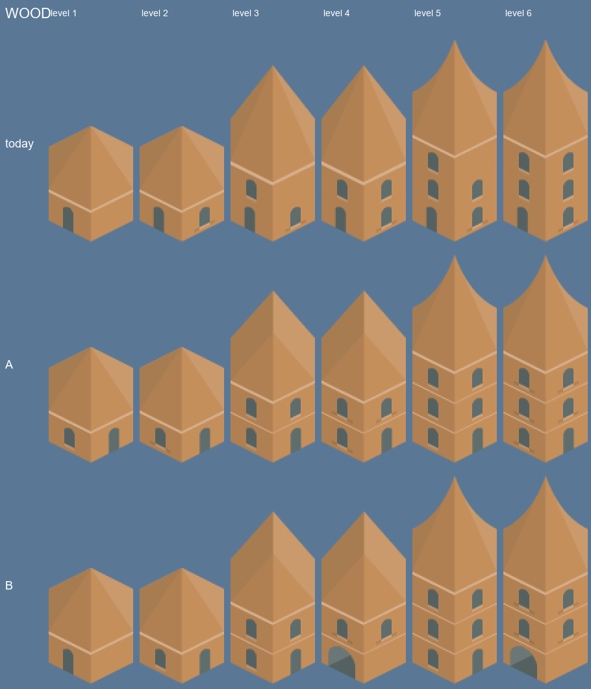
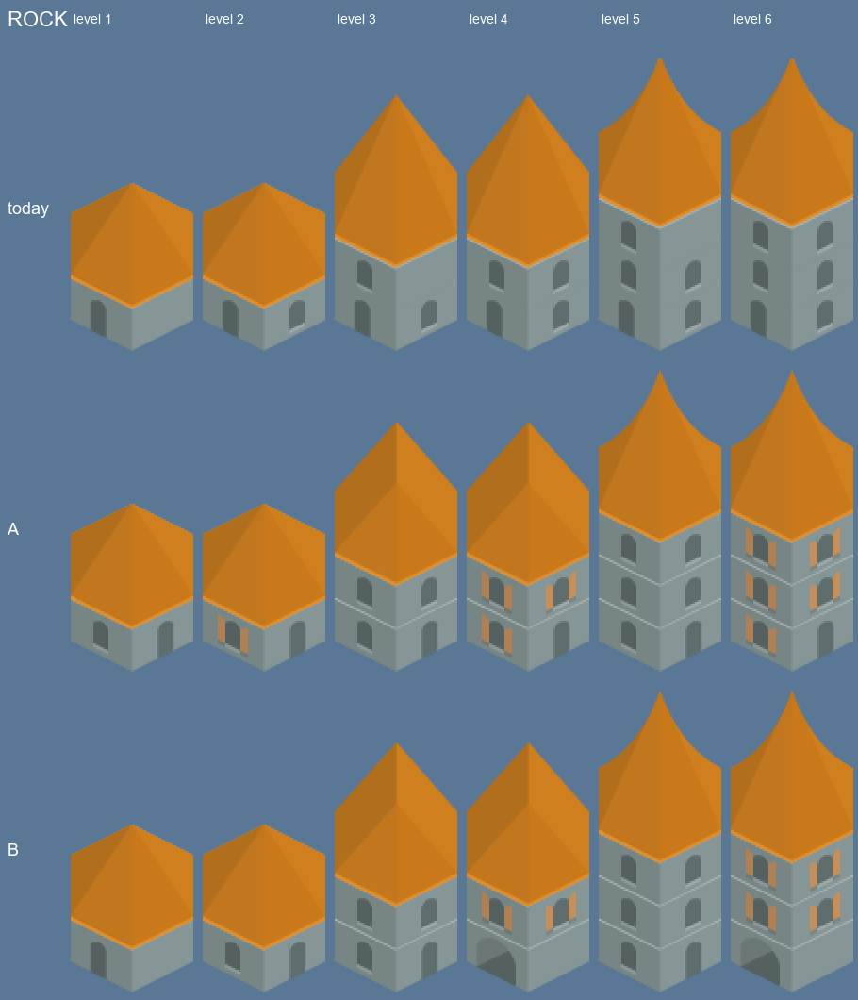
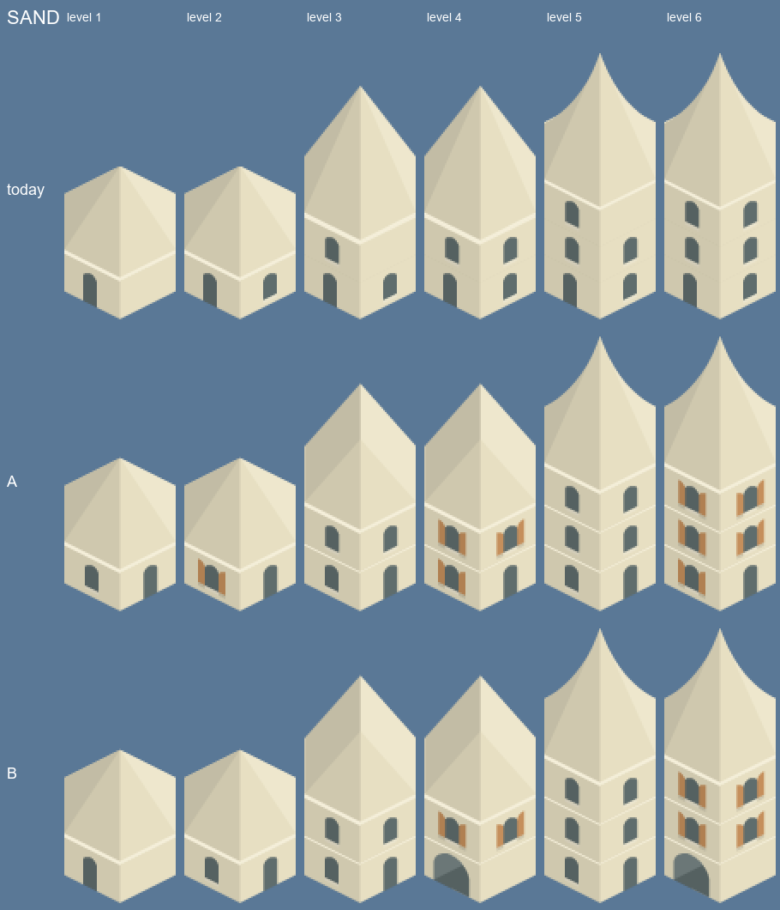
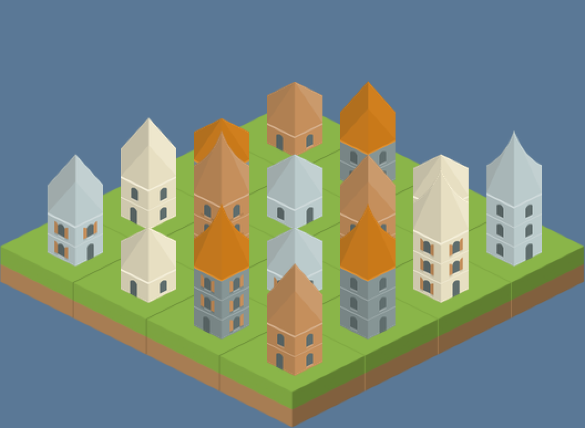
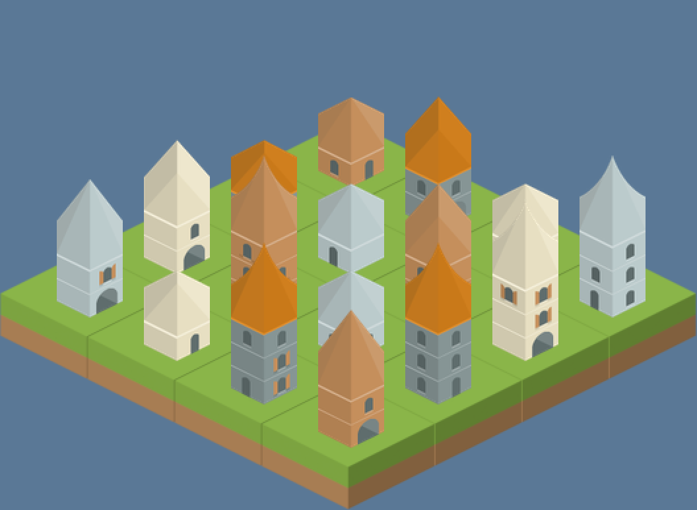

# Building recipes
<!-- index | refs: #59, PR pending | area: Buildings -->

**Date:** 2026-11-11 · **Area:** Buildings · **Issues:** [#59](https://github.com/vectorviolet/highrise/issues/59)

## Context

Today's building sprites (`assets/images/buildings/<age>/level1..6.png`) are hand-made composites
of the Kenney Hexagon Buildings pieces. Levels 1 and 2, 3 and 4, and 5 and 6 look identical, every
base level has the door on the left, and rock's red roof sits on grey walls while the other ages
use their own roof color. #59 proposes composing sprites in code from recipes in
`config/buildings.yaml` (floors bottom to top, then a roof), with per-building variants picked
when a building is built.

This is phase 1: two recipe styles rendered next to today's sprites, so the owner can pick.
Nothing in the game uses the recipes yet. `scripts/render_building_styles.py` reads
`config/buildings.yaml` and the raw pack pieces and writes the images below.

How a sprite is composed (same rule for all styles and ages): the ground floor piece (65x89) sits
at the bottom, each further floor 23 px higher (the game's own floor step), and the roof is
aligned so its base lands on the top floor's top edge. Footprint (65 px wide), foot position
(bottom edge) and the floor count per level (1, 1, 2, 2, 3, 3) match today's; the roof pieces
change the total height slightly.

## Options

- **A, close to today:** a door+window floor, plain windows above, short / straight / pointy roof
  for levels 1-2 / 3-4 / 5-6. Even levels use the blinds pieces so they differ from the odd ones
  (today they are identical). Variety: only which side the door is on.
- **B, more varied:** every floor and roof slot lists several pieces (door left/right,
  door+window, blinds, gates, left/right-only windows, short/rounded, straight/tall roofs). Level
  1 and 2 use a short or rounded roof, 3 and 4 a straight or tall one, 5 uses pointy or tall, 6
  pointy. Gates only appear from level 3.

Per age (rows: today, A, B; default variants only):

A 4x4 board with variety on (seeded, the same mix of ages and levels in both):

Pack pieces used (all from `Tiles/` of the Kenney Hexagon Buildings pack, CC0): per age
`DoorWindow`, `DoorWindowMirror`, `DoorWindowBlinds`, `DoorWindowBlindsMirror`, `Windows`,
`WindowBlinds`, and for B also `DoorLeft`, `DoorRight`, `GateLeft`, `GateRight`, `WindowLeft`,
`WindowRight`, `WindowBlindsLeft`, `WindowBlindsRight`; roofs `RoofShort`, `RoofRounded`,
`RoofStraight`, `RoofTall`, `RoofPointy`. Rock uses the pack's `red` roofs. Phase 2 would copy
these into `assets/` with `SOURCES.yaml` entries.

## Decision

Pending owner: pick A or B (and any per-age tweaks).

## Rejected alternatives

None yet.

## Result

Phase 2 (game loads recipes, old PNGs removed, variants saved) waits for the pick.
