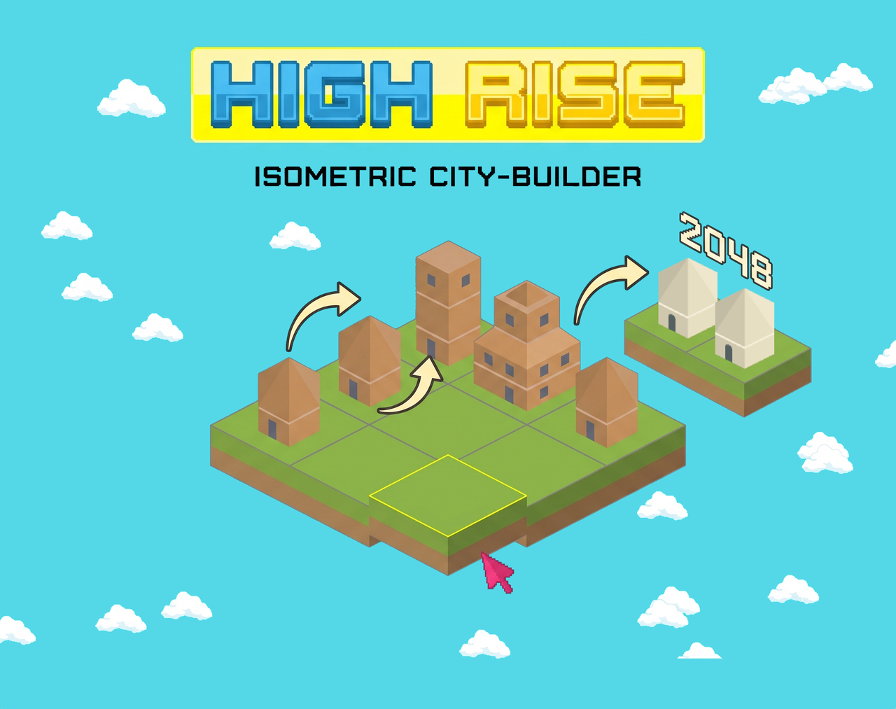
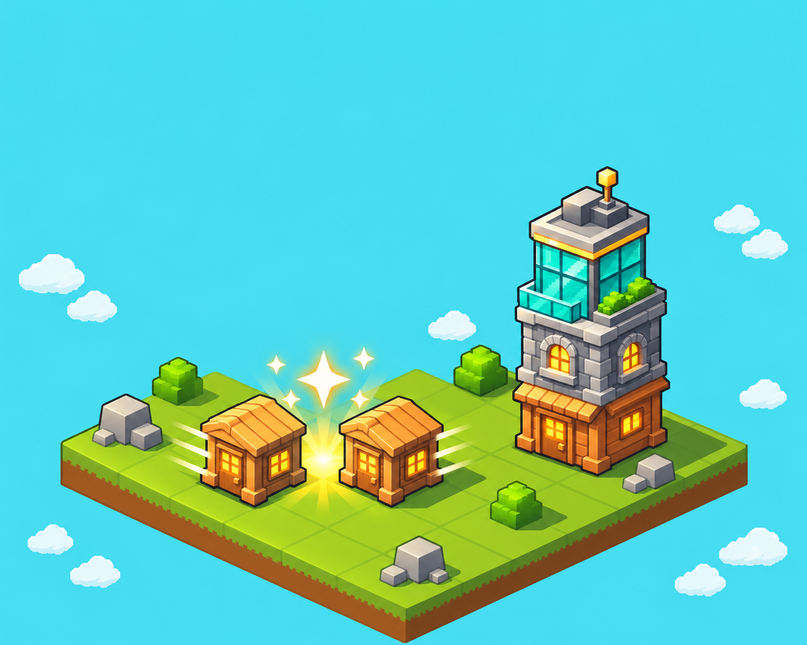
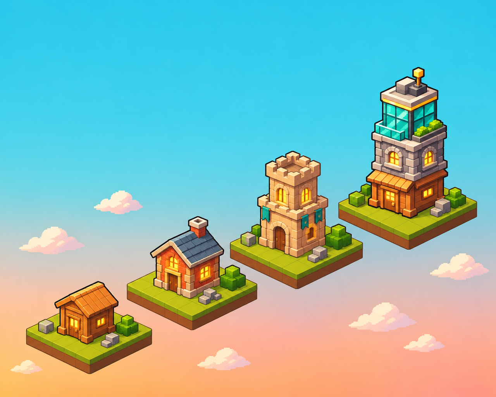
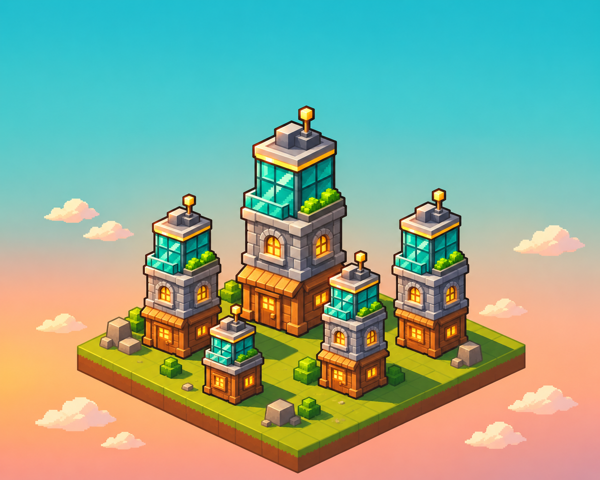
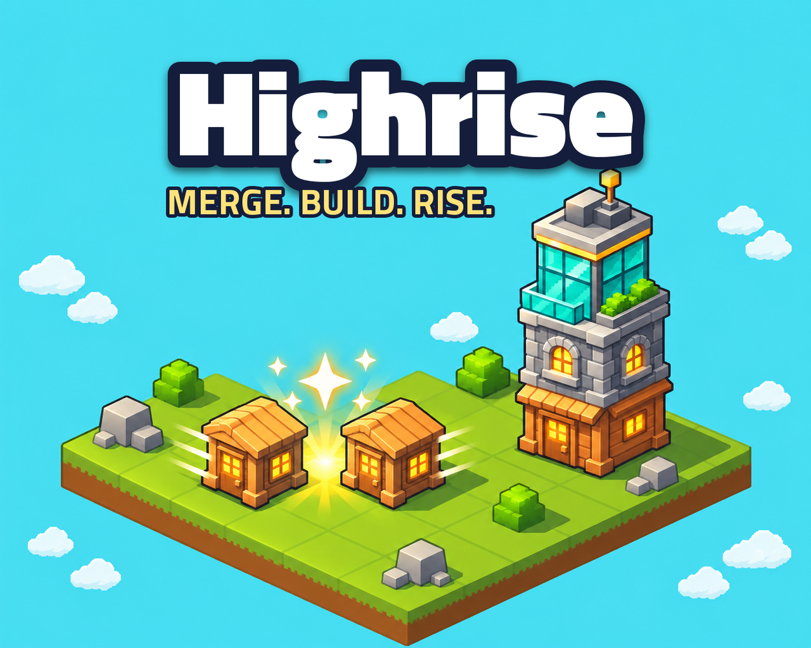
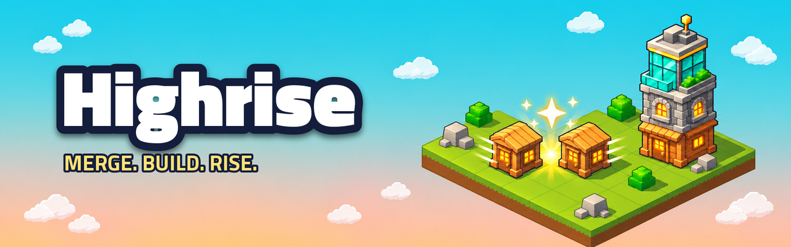

# Cover and banner
<!-- index | refs: #89, PR #90 | area: Art -->

**Date:** 2026-11-11 · **Area:** Art · **Issue:** [#89](https://github.com/vectorviolet/highrise/issues/89)

## Context

The store page cover was a Gemini ("nano banana") image from before the icon existed, and it no
longer matched the game's look. The owner generated new art with OpenAI Codex (image generation)
in the style of the icon: text-free, so the title can be set in the game's own font and changed
later. The itch.io page also needed a wide banner.

## Options

**The old cover against the new art.** The old Gemini cover first, then the three new text-free
arts: the merge island (two houses merging into the icon's tower), four ages on a sunset sky, and
five towers at golden hour.

**The tagline on the cover.** "MERGE. BUILD. RISE." fits under the title, left of center, and stays
clear of the tower's antenna. Centered, it ran into the antenna, so it sits to the left.

## Decision

- **Cover:** the merge art. It shows the game's one idea (merge, and the result is taller) and the
  icon's tower. It keeps its native 1402x1122 size (no upscaling); `docs/store/cover-itchio.png`
  is a 630x500 copy.
- **Key art:** the ages art and the golden-hour art are kept, text-free and unchanged, in
  `docs/design/art/`, even though the store doesn't use them yet.
- **Banner:** the wide merge art (1920x600, title and tagline in the empty sky on the left), with a
  960x300 preview. Pages show the banner at about 960 px, so 1920 px is 2x.
- **One title definition:** `scripts/make_cover.py` draws the title (Titillium Web Black, white,
  dark navy outline `#141D3B`, soft shadow) and the tagline (Bold, yellow, same outline) for both
  images, so changing the text or a color is one edit and a rerun.

## Rejected

- Two earlier drafts: their style didn't match the icon and the game's pixel art.
- Upscaling the cover to the old 2304x1824: it would only blur the pixel art.

## Result

Rights: all of the art was generated by the owner with OpenAI Codex and approved by the owner; it
is not CC0. The old Gemini cover is gone from the tree (git history keeps it).
