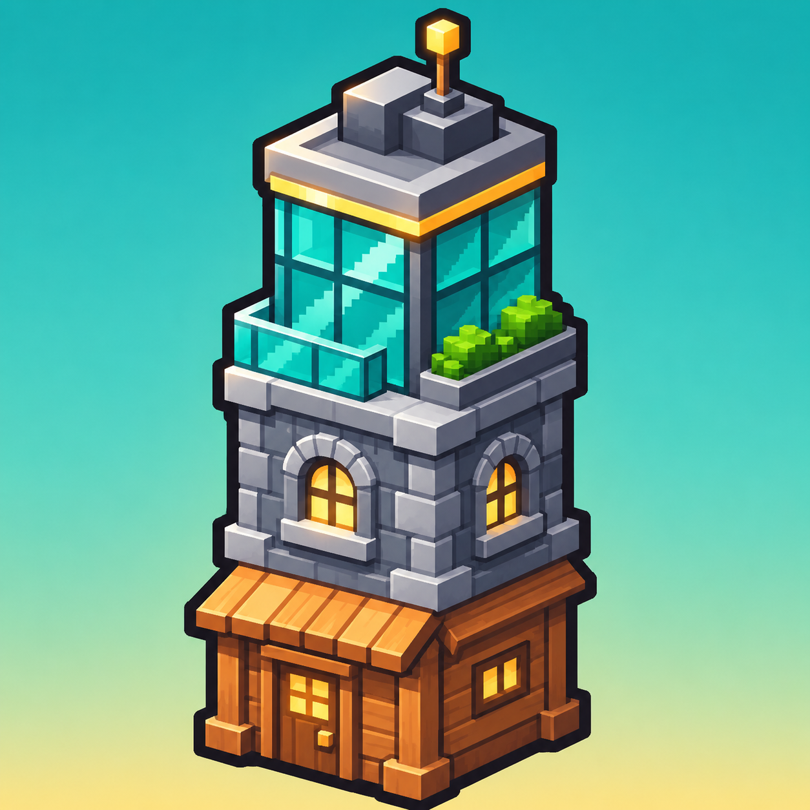
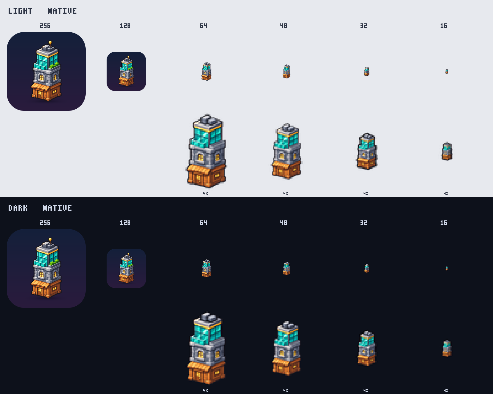

# Game icon
<!-- index | refs: #79 | area: Art -->

**Date:** 2026-11-11 · **Area:** Art · **Issue:** [#79](https://github.com/vectorviolet/highrise/issues/79)

## Context

Highrise had no icon: the window, the taskbar, the executable and the store page all showed the
defaults. The owner generated a pixel-art tower with OpenAI Codex (image generation, from a text
prompt) and approved shipping it. The result was post-processed with a NumPy script (cutout, plate,
small sizes).

## Options

**Master: the AI original or a plate.** The original has a gradient background that fills the
whole square. A square image with a baked-in gradient looks wrong as an icon (it clashes with the
rounded corners the OS and the store apply). The alternative is the tower cut out and set on a
navy rounded plate, which works on both light and dark backgrounds.

**Small sizes: a plate or no plate.** At 32 px and below the plate's margin takes about a third
of the pixels, so the tower shrinks to a few pixels. For 64, 48, 32 and 16 px the tower is
cut out without a plate and simplified, so it fills the icon. The preview sheet shows every size
at native size and at 4x, on a light and a dark background:

## Decision

The owner approved the plate master (1024 px) for the README, the store page and the 256 and 128
px sizes, and the plate-less tower for 64 px and below.

- `packaging/icon.ico` (6 sizes) is the executable's icon (`icon=` in `highrise.spec`).
- `assets/images/icon/icon_64.png` is the window icon, set with `pygame.display.set_icon` after
  the Application creates the window (pygamine has no icon API; the engine was not changed).
- `docs/design/icon.png` is the 1024 px master, also shown at the top of the README.

## Rejected

- Shipping the original gradient image: the background is part of the image, so it shows as a
  square block on dark taskbars and in store listings.
- The plate at 32 px and below: the tower becomes too small to read.

## Result

The window and taskbar show the tower. The executable icon needs a PyInstaller build to be seen
and was not checked in this PR. The macOS `.app` bundle still has no icon (it needs an `.icns`).
Rights: AI-generated by the owner, approved by the owner; listed as `own` in `assets/SOURCES.yaml`,
not CC0.
