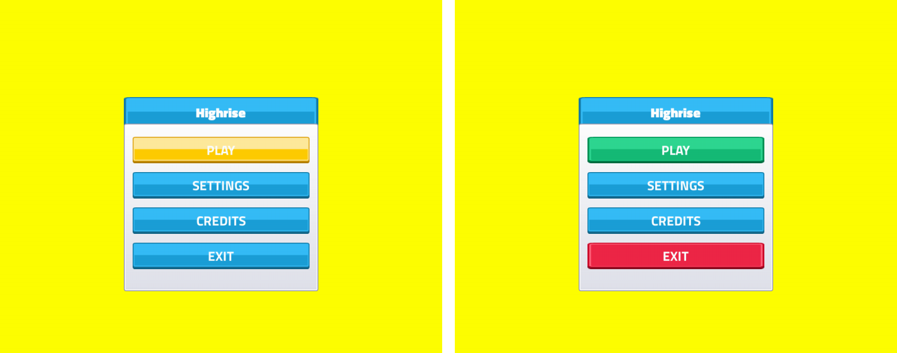
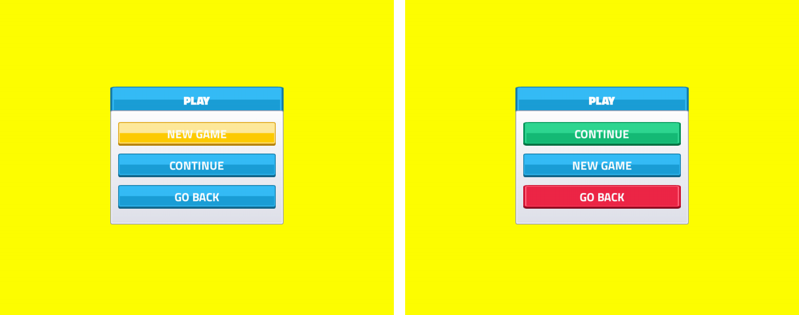
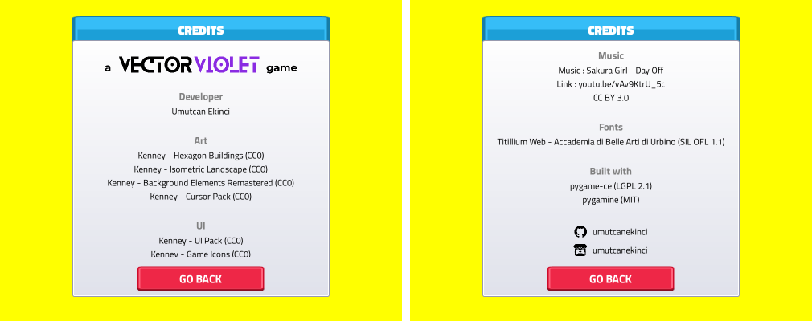

# Menu polish
<!-- index | refs: #55, #62, #63, #66, PR #67 | area: UI -->

**Date:** 2026-11-11 · **Area:** UI · **Issues:** [#55](https://github.com/vectorviolet/highrise/issues/55), [#62](https://github.com/vectorviolet/highrise/issues/62), [#63](https://github.com/vectorviolet/highrise/issues/63), [#66](https://github.com/vectorviolet/highrise/issues/66)

## Context

Four small menu cards, one PR: a color scheme for the buttons, CONTINUE above NEW GAME, a percent format that follows the language ("60%" in
English, "%60" in Turkish; English showed "%60").

## Decisions

- **Button colors (#63):** red leaves, cancels or destroys (EXIT, every GO BACK, CANCEL, SELL),
  green is the main "go" action (PLAY, CONTINUE, SAVE, BUILD), blue is everything else (SETTINGS,
  CREDITS, NEW GAME, the settings tabs). `tests/test_menu_polish.py` lists every button's color.
  SELL was green with a red hover; it is now red with the usual yellow hover.
- **CONTINUE first (#55):** CONTINUE is the top button of the PLAY page, NEW GAME below it, GO BACK
  last; the keyboard focus order follows. The PLAY page is only reached when a save exists (PLAY
  starts a new game directly otherwise), so CONTINUE is never disabled and nothing leaves a gap.
- **Percent format (#62):** `common.percent` in the language files ("{value}%" / "%{value}"), used
  by the volumes and the UI scale; a language change re-texts the open values.
- **Headers (#56, not done):** I built two header styles that don't look like buttons (a purple
  plate and a slate banner) and showed them side by side. The owner rejected both: the headers stay
  as they were (a blue button-shaped plate, and the main menu title), and #56 was closed as not planned. The code
  for both styles was removed again.
- **Credits branding (#66):** the CREDITS page opens with the "a VECTORVIOLET game" lockup and
  closes with GitHub and itch.io rows (icon + username, each pair centered), as on Chokepoint's
  page. The three images ship with pygamine (`source: branding`, the light-page variants), so no
  asset files or strings were added.

## Result

Before (left) and after (right):

The CREDITS page, top of the scroll (the lockup) and its end (the profile rows):

