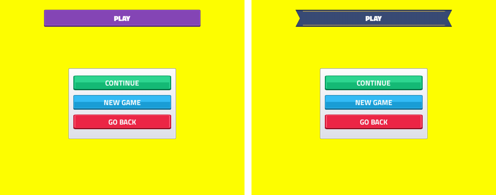
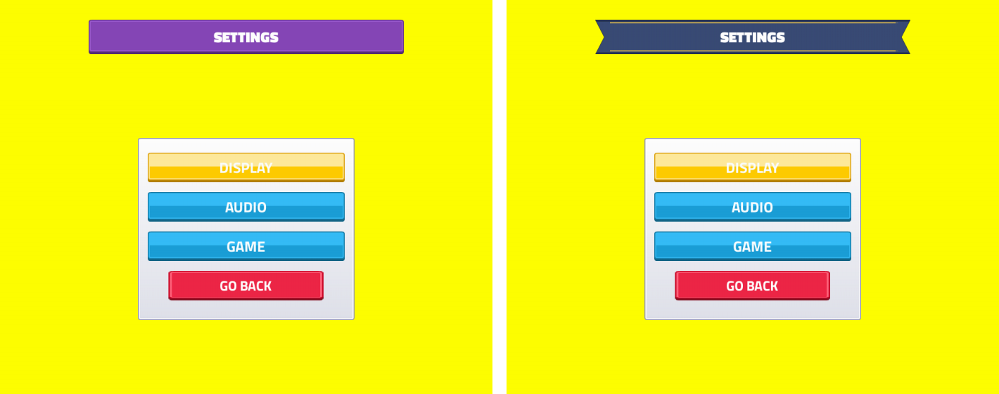
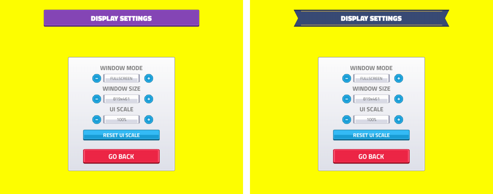
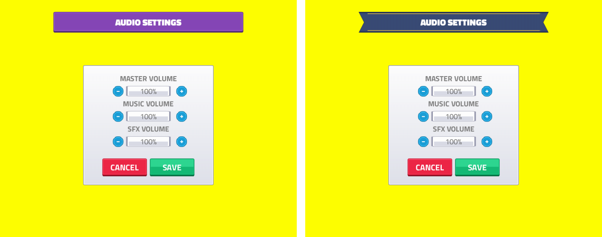

# Menu polish
<!-- index | refs: #55, #56, #62, #63, #66 | area: UI -->

**Date:** 2026-11-11 · **Area:** UI · **Issues:** [#55](https://github.com/vectorviolet/highrise/issues/55), [#56](https://github.com/vectorviolet/highrise/issues/56), [#62](https://github.com/vectorviolet/highrise/issues/62), [#63](https://github.com/vectorviolet/highrise/issues/63), [#66](https://github.com/vectorviolet/highrise/issues/66)

## Context

Four small menu cards, one PR: a color scheme for the buttons, page headers that can't be mistaken
for buttons, CONTINUE above NEW GAME, and a percent format that follows the language ("60%" in
English, "%60" in Turkish; English showed "%60").

## Decisions

- **Button colors (#63):** red leaves, cancels or destroys (EXIT, every GO BACK, CANCEL, SELL),
  green is the main "go" action (PLAY, CONTINUE, SAVE, BUILD), blue is everything else (SETTINGS,
  CREDITS, NEW GAME, the settings tabs). `tests/test_menu_polish.py` lists every button's color.
  SELL was green with a red hover; it is now red with the usual yellow hover.
- **CONTINUE first (#55):** CONTINUE is the top button of the PLAY page, NEW GAME below it, GO BACK
  last; the keyboard focus order follows. The PLAY page is only reached when a save exists (PLAY
  starts a new game directly otherwise), so CONTINUE is never disabled and nothing leaves a gap.
- **Percent format (#62):** `common.percent` in the language files ("{value}%" / "%{value}"), used
  by the volumes and the UI scale; a language change re-texts the open values.
- **Headers (#56):** the blue button-shaped plates are gone. Every sub-page header is one plate at
  one place (640x70, centered, 140 px from the top), with no hover state. The main menu has no
  header (it showed "Highrise" in a blue plate before).

- **Credits branding (#66):** the CREDITS page opens with the "a VECTORVIOLET game" lockup and
  closes with GitHub and itch.io rows (icon + username, each pair centered), as on Chokepoint's
  page. The three images ship with pygamine (`source: branding`, the light-page variants), so no
  asset files or strings were added.

## Options: the header style

Two candidates, switchable with `ui.header_style` in `config/settings.yaml` (`a` or `b`; the code
default is `a`). Each style is a manifest in `config/header_styles/` that defines `header_plate`.
Left is style a, right is style b.

- **a, plate:** the UI Pack's button plate, hue-shifted to purple (a color no button uses).
- **b, banner:** a slate ribbon with swallowtail ends and a gold edge, drawn by
  `scripts/gen_header_art.py` (the same script makes both images).

**Decision: pending the owner's pick.**

## Result

Before (left) and after (right):

Header text fits in English and Turkish at every UI scale (`tests/test_menu_polish.py`).

The CREDITS page, top of the scroll (the lockup) and its end (the profile rows):

