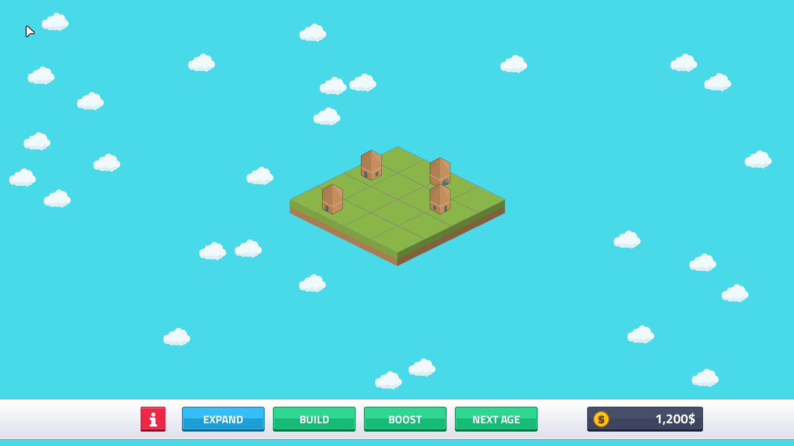
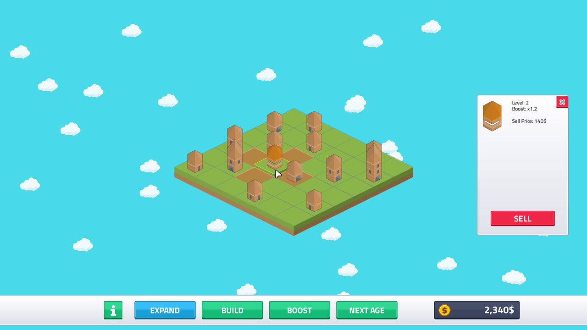
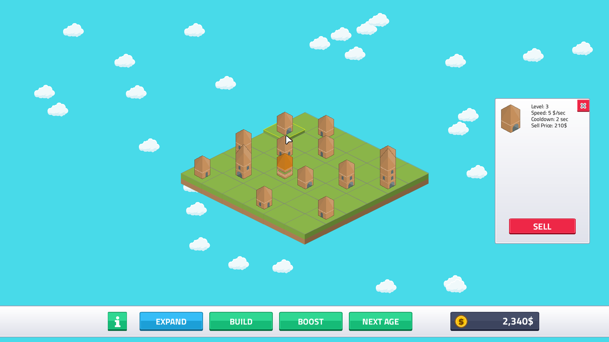
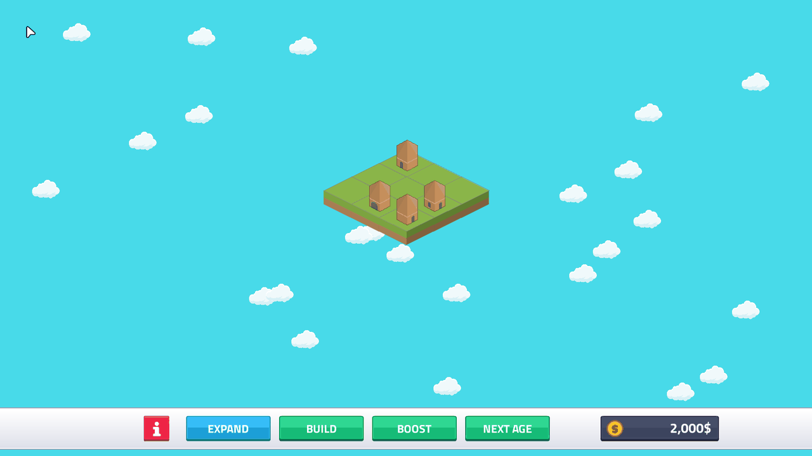
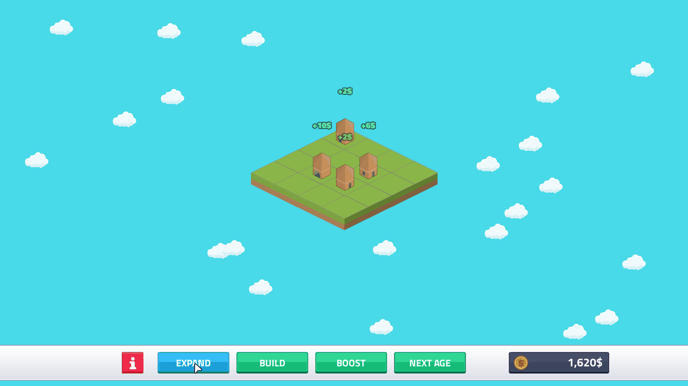
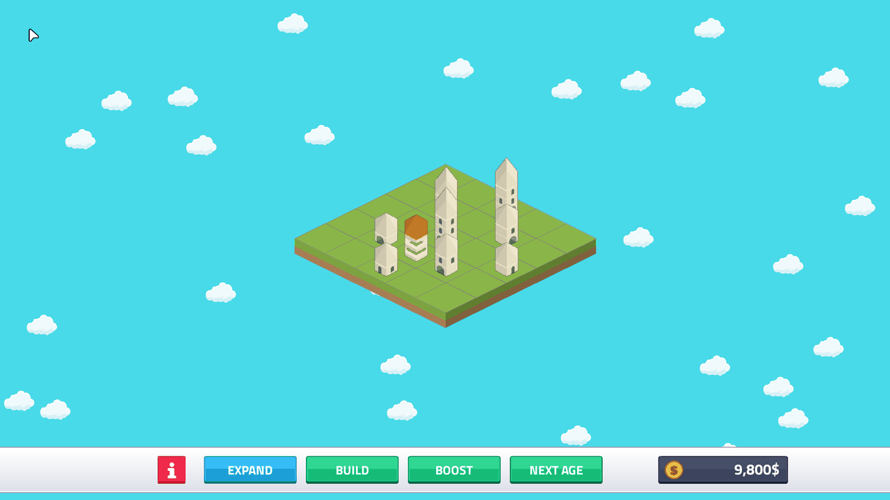
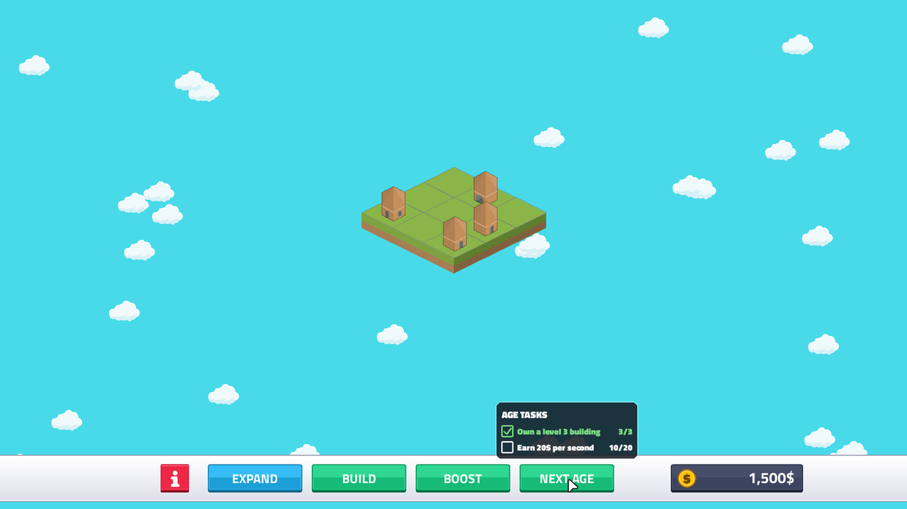
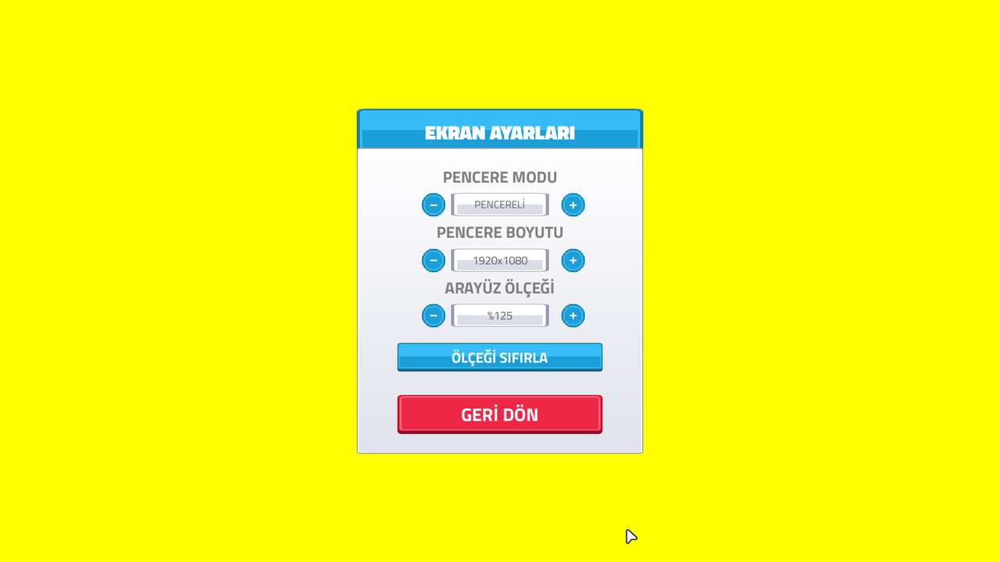
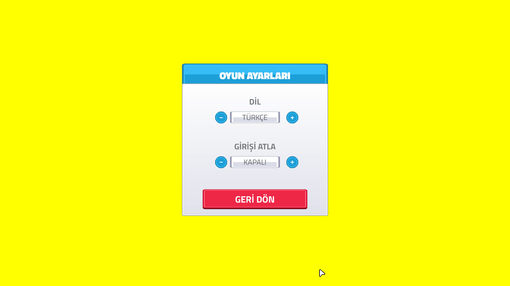

# README screenshots and preview GIF
<!-- index | refs: #44, PR #81 | area: Docs -->

**Date:** 2026-11-11 · **Area:** Docs · **Issue:** [#44](https://github.com/vectorviolet/highrise/issues/44)  · **PR:** [#81](https://github.com/vectorviolet/highrise/pull/81)

## Context

The README's three screenshots and its preview GIF were from before the sprite recipes, the
outline, boosters, age tasks, the cash display, the new menu buttons and the CREDITS page. They
showed a different game (a different font, a "DEVELOPER" button, a plain black cash box).

## What was retaken

`docs/preview.gif`, `docs/screenshots/01_main_menu.png`, `02_build_mode.png` and
`03_inspection.png` (same names, 1280 px wide at most). They come from
`scripts/capture_readme.py`: it boots the real `Game` headless, drives it by calling its own
methods (BUILD, BOOST, the arrow-key moves, the inspection click), and writes the pictures. Saves
go to a temporary folder (never `databases/`), the random numbers are seeded and the clock is a
fake one, so two runs write byte-identical files. When a visual change lands, run it and commit
the changed pictures:

```
uv run --group dev python scripts/capture_readme.py
```

- **01 main menu:** the new menu, the mouse on PLAY.
- **02 build mode:** a 6x6 board of buildings up to level 7 and a booster; the mouse is on the
  booster, so the tiles it covers are lit, and the payouts' texts float over the buildings.
- **03 inspection:** a level 5 building's info panel with the SELL button.
- **preview.gif:** BUILD twice, three slides that merge buildings, then BOOST and the payouts
  coming in (about 8 s, 0.65 MB).

## Candidates (not in the README yet)

All in `img/screenshots-2026-11/`, taken the same way. The issue's shot list, as candidates:

Merge in progress, and inspecting a booster (its multiplier, covered tiles lit) next to a normal
building with the sell option:





Expanding the land, before and after:




A later age (sand, buildings up to level 8) and the NEXT AGE checklist on hover:




Settings in Turkish: the DISPLAY page at UI scale 125% and the GAME page:




## Decision

Pending: the owner picks which candidates (if any) go into the README, or into the store page.
Nothing from this folder is linked from the README yet.
