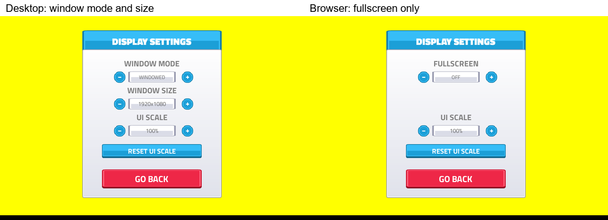
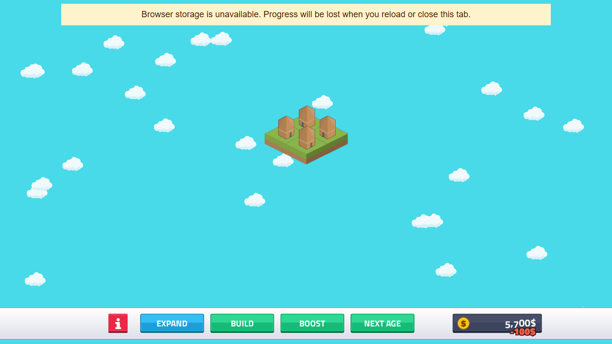
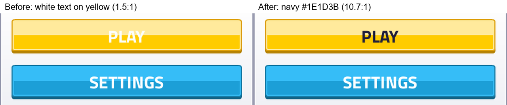
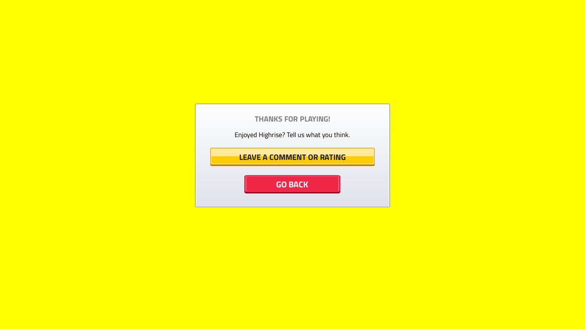

# Browser build
<!-- index | refs: #97, PR #102 | area: Web, persistence -->

**Date:** 2026-11-18 · **Area:** Web, persistence · **Issue:** [#97](https://github.com/vectorviolet/highrise/issues/97) · **ADR:** [0004](../decisions/0004-web-build.md)

## Context

The owner wanted Highrise in the browser (itch.io HTML5), like Chokepoint, for desktop browsers
with a keyboard and mouse. Highrise differs from Chokepoint in three ways: startup loads a SQLite
board and settings before the loop, the board is saved only when the player leaves it, and its
motion is per update rather than per second.

## Options

- **Saves:** SQLite on pygbag's temporary filesystem (lost on reload), or the engine's
  `SaveStore` in localStorage as Chokepoint does. A first version wrapped `SaveStore` in its own
  store with a five-state write outcome, five localized notices, a hand-written validator and an
  invalid-save state machine (about 360 lines of source and 900 of tests). Review found it
  over-built and reaching into `SaveStore`'s private attributes.
- **When to save:** only on ESC (as on desktop), on a timer, or after each change.
- **Frame rate:** step the whole world 2.75 times a frame, or only the part whose motion is per
  update.
- **Music:** keep the MP3 on desktop, or OGG everywhere.
- **Menus:** the browser has no window modes or resolution, so the DISPLAY page shows a
  fullscreen row instead (left: desktop, right: browser).

## Decision

- **Saves:** `SaveStore` as it is, and the desktop's clamping reused. One "browser storage is
  unavailable" notice, shown when a read-back after saving differs. An unreadable stored save is
  kept until an explicit New Game. Settings write failures are only logged by the engine; a
  corrupt settings blob is logged and replaced by defaults. Web persistence is now one module of
  about 220 lines (was about 360 in three), and the browser tests are about 390 lines (was about 500 for the same area, plus the removed store tests).
- **Saving:** a closed tab raises no QUIT, so the board saves 2 s after a build, sell, move,
  merge, NEXT AGE or expand (a burst is one write, a merge in progress is waited out), on ESC,
  and every 10 s while the board is open if money or the board changed (idle payouts).
- **Notice:** one text, shown when the browser blocks localStorage (`SaveStore` then keeps data
  in memory and looks fine, so `util/web.storage_available()` probes it once) or refuses a
  write (a read-back after saving catches it). It is a box in the page, so it is drawn by the
  browser; the picture is the template's own rule over a board shot.

- **Frame rate:** pygbag presents 60 frames a second, while building and cloud motion steps once
  per update, tuned for 165 updates a second. Payout timers, the credits scroll and the floating
  texts use real time. A desktop update steps the buildings twice (the game panel's own update,
  and the world's) and each cloud kind once; counting them showed the first browser version
  (one step each) was about 30% slow for buildings and 2.75x slow for the game's clouds. The
  browser now runs the same steps per second (`tests/test_web.py` counts them against desktop),
  everything else once a frame, and drops stalls over 50 ms. Frame time in a browser has not
  been measured.
- **Button text on yellow:** every button's hover face is the yellow `yellow_button` (#FFCC00),
  and the white label on it was 1.5:1 (the Thanks screen's rate button shows it too, as the
  keyboard-focused first button). Labels on a yellow face are now navy #1E1D3B (10.7:1); blue,
  red and green faces keep white. pygamine's `TextObject` has one color but already switches
  state with its button's hover, so the game's `ButtonText` (`type: button_text` in
  `panels.yaml`) has a hover state that mirrors the text and takes the navy color, and also
  follows keyboard focus. No engine change.

- **Exit:** a Thanks screen with the rate link (the owner approved its texts).

- **Music:** OGG everywhere (CC BY 3.0 section 3 allows a format-only change, so the public credits stay as they were;
  SOURCES.yaml records the transcode, as in Chokepoint). The file shrinks from 7.4 to 3.9 MB.
- **Also in the branch:** `ALPHA_BLIT` on the translucent blits (the browser's SDL2 build lacks
  `BLEND_ALPHA_SDL2`; desktop looks the same), a `thanks` screen on Exit with a rate link (the
  owner approved its texts), and browser fullscreen instead of window modes.

## Rejected alternatives

- A custom store class with write outcomes and a session cache: too much for a small JSON save.
- A timer-only autosave: it would cut merge animations short.
- Reading `SaveStore._web` and patching `_browser_storage` in tests: private coupling. Tests fake
  `platform.window` instead, as Chokepoint's do.
- Publishing a web-only GitHub Release when the desktop build failed: releases are the owner's
  call.

## Result

Reload, Continue, fullscreen and Exit worked in Chrome (owner playtest, 2026-11-17, before the
simplification). The simplified save path still needs one browser check: build, close the tab
without ESC, reopen, Continue.
